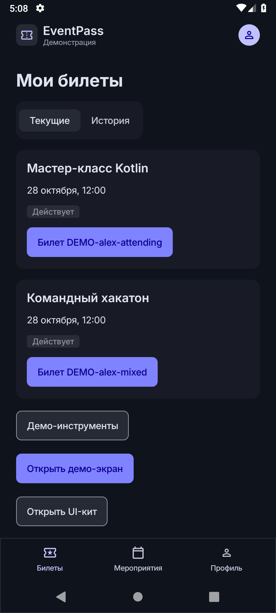
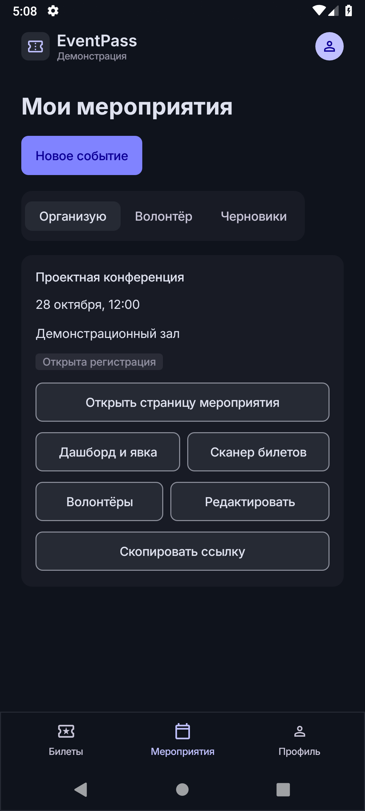
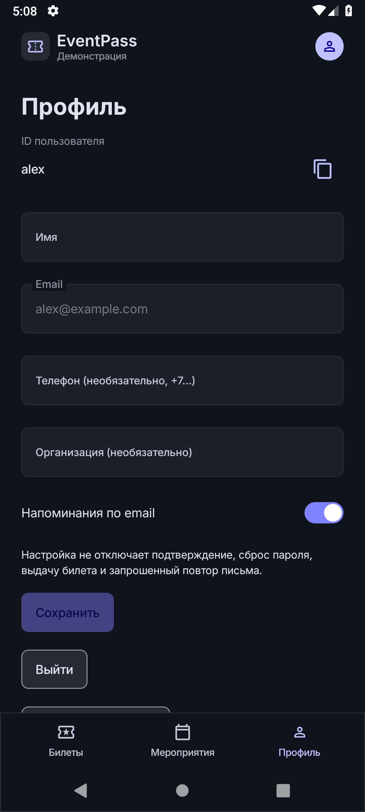
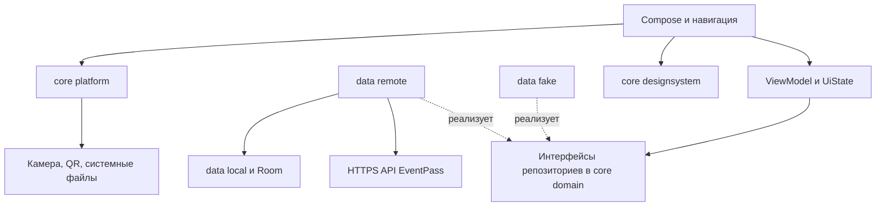

# EventPass для Android

Мобильное приложение для организации мероприятий, регистрации участников и контроля входа по QR-кодам.

## Цель проекта

EventPass объединяет путь от публикации мероприятия до проверки билета на входе. Участник открывает событие по ссылке, заполняет анкету и получает билет. Организатор управляет событием, командой волонтёров и явкой. Один аккаунт может быть организатором одного мероприятия и участником другого — права назначаются для конкретного события.

Этот репозиторий содержит Android-клиент и его документацию. Backend развивается в [отдельном репозитории](https://github.com/EgorDikanskiy/eventpass). Макеты и компоненты интерфейса подготовлены в [Figma](https://www.figma.com/design/i2NNhWGwunnvhZZX3GPuSR/Untitled?node-id=0-1).

## Возможности

| Сценарий | Что доступно |
| --- | --- |
| Участник | Открытие события по ссылке, анкета с разными типами вопросов, регистрация, QR-билет, текущие билеты и история, отмена участия |
| Организатор | Создание и редактирование событий, обложки, программа, конструктор анкеты, черновики, публикация и завершение события |
| Команда мероприятия | Выдача и отзыв прав волонтёров, CameraX-сканер, ручной ввод номера билета, история проверок |
| Аналитика | Счётчики явки, поиск и постраничный список участников, ответы в карточке участника, распределение ответов по вопросам |
| Аккаунт | Вход, регистрация, восстановление пароля, подтверждение email, редактирование профиля и удаление аккаунта |
| Документы | Получение PDF-билета и выгрузки XLSX через системный выбор места сохранения |
| Интерфейс | Три независимые вкладки, обновление жестом, заставка запуска, скелетоны загрузки и сохранение состояния экранов |

### Билеты из PDF

В `remoteDebug` доступен экспериментальный локальный импорт сторонних PDF-билетов. PDFBox извлекает текст и позиции элементов, Tesseract выполняет OCR, ZXing ищет QR и линейные штрихкоды. Пользователь проверяет найденные поля перед сохранением. Карточки и оригиналы сохраняются на устройстве, билеты можно листать свайпами и открывать код на весь экран.

Импорт работает с разными документами и может требовать ручного уточнения полей. Эта функция поставляется только в debug-варианте. Подробности обработки, ограничения распознавания и результаты проверок описаны в [AIP-004](docs/architecture/aip004-ticketvault.md).

## Скриншоты

Снимки демонстрационной сборки с синтетическими данными, снятые на эмуляторе Android 9. Вариант `demo` позволяет исследовать интерфейс без сервера и использует собственные продуктовые сценарии.

<table>
  <tr>
    <td align="center"><br>Билеты</td>
    <td align="center"><br>Мероприятия</td>
    <td align="center"><br>Профиль</td>
  </tr>
</table>

## Архитектура

Приложение использует MVVM и однонаправленное обновление интерфейса. Compose-экран получает состояние из ViewModel и передаёт ей действия пользователя. ViewModel обращается к интерфейсам репозиториев, а Hilt подключает нужную реализацию для выбранного варианта сборки.



| Модуль | Ответственность |
| --- | --- |
| `app` | Activity, навигация, экраны, ViewModel и сборка зависимостей |
| `core:domain` | Предметные модели, контракты репозиториев и правила приложения |
| `core:designsystem` | Тема, цвета, типографика и общие Compose-компоненты |
| `core:platform` | CameraX, кодирование QR, системные ссылки, файлы и платформенные адаптеры |
| `data:remote` | HTTP, серверные модели, сессия и реализации репозиториев для API |
| `data:local` | Room-хранилище черновиков и локальных команд синхронизации |
| `data:fake` | Данные и реализации репозиториев демонстрационной сборки |

Три корневых стека сохраняют состояние вкладок «Билеты», «Мероприятия» и «Профиль». Права и окончательный результат регистрации или проверки билета определяет сервер. Смена аккаунта очищает приватное состояние, а ответы завершившихся запросов проверяются на принадлежность текущей сессии. Гостевой доступ к QR хранится в saved state текущего сценария.

[Подробная архитектура](docs/02-architecture.md) · [Навигация](docs/03-navigation.md) · [Ответственность компонентов](docs/architecture/responsibilities.md) · [Инженерные соглашения](docs/14-engineering-rules.md)

## Технологии

- Kotlin 2.4.21, Jetpack Compose и Material 3.
- MVVM, Hilt 2.60.1, Navigation 3.
- Coroutines, Flow, Kotlin Serialization и OkHttp.
- Room 2.8.5 для локальных черновиков.
- CameraX и ZXing для работы с кодами.
- PDFBox Android и tess-two для экспериментального импорта PDF.
- Gradle Wrapper 9.5.0, Android Gradle Plugin 9.3.3, JDK 21.

Минимальная версия — **Android 9 / API 28**, compile и target SDK — **37**. Точные версии зависимостей закреплены в [каталоге Gradle](gradle/libs.versions.toml).

## Запуск

Установите Android Studio, JDK 21 и Android SDK 37. Откройте корень репозитория как Gradle-проект и настройте путь к SDK через Android Studio или `local.properties`.

```powershell
.\gradlew.bat :app:assembleRemoteDebug
.\gradlew.bat :app:installRemoteDebug
```

APK появляется в `app/build/outputs/apk/remote/debug/`. Для запуска без backend выберите вариант `demoDebug` в Android Studio или соберите его отдельно.

```powershell
.\gradlew.bat :app:assembleDemoDebug
.\gradlew.bat :app:installDemoDebug
```

| Вариант | Назначение |
| --- | --- |
| `remoteDebug` | Работа с API и экспериментальный импорт PDF |
| `demoDebug` | Локальные сценарии и демонстрационные данные |
| `remoteRelease` | Оптимизация R8 и уменьшение ресурсов, сборка без подписи |

Для production-поставки потребуется настроить собственную release-подпись. `demoRelease` отключён.

По умолчанию remote обращается к `https://eventpass.dikanskii.ru/api/`. Другой HTTPS-адрес можно передать свойством сборки.

```powershell
.\gradlew.bat :app:assembleRemoteDebug -Peventpass.apiBaseUrl=https://example.org/api/
```

## Проверки

```powershell
.\gradlew.bat :core:domain:test :data:fake:test
.\gradlew.bat :app:testRemoteDebugUnitTest :data:remote:testDebugUnitTest
.\gradlew.bat :app:lintRemoteDebug :app:verifyDemoIsolation
python scripts/verify-architecture-docs.py
```

Проверки staging и живого API включаются отдельно и используют синтетические данные. Подробные команды, результаты и ограничения приведены в [матрице M09](docs/validation/t10-m09-final-validation.md).

## Текущий срез

Последняя описанная сборка — **0.10.21-instant-navigation-remote, code38**. Она включает заставку запуска, скелетоны загрузки, мгновенную смену корневых вкладок и согласованную смену шапки при входе в PDF. Для code38 на Android 9 прошли три адресные UI-проверки навигации, установка и запуск подтверждены на Redmi. Общая приёмка релизной поставки и результаты прежних сборок учитываются отдельно в [плане](docs/06-delivery-plan.md).

Android App Links отложены. Текущие правовые материалы находятся в состоянии проектов для согласования оператором. Ограничения API и интеграции перечислены в [требованиях backend](docs/32-backend-final-requirements.md) и [плане миграции](docs/34-api-migration-plan.md).

## Документация

- [Карта документации](docs/00-documentation-map.md).
- [Архитектура и связи модулей](docs/02-architecture.md).
- [Продуктовые решения](docs/08-decisions.md).
- [План разработки и проверенные сборки](docs/06-delivery-plan.md).
- [API и принятые изменения backend](docs/34-api-migration-plan.md).
- [Импорт сторонних PDF-билетов](docs/architecture/aip004-ticketvault.md).
