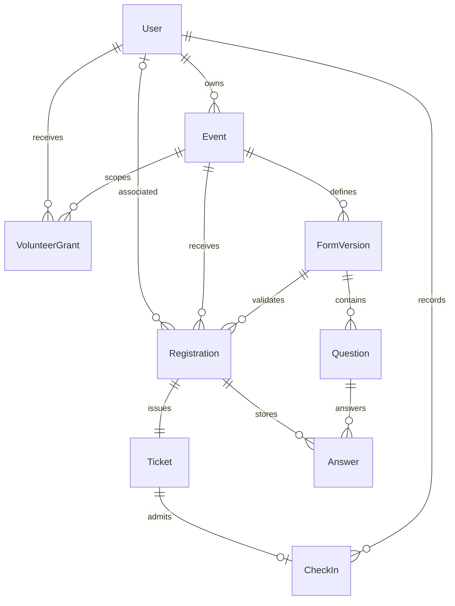
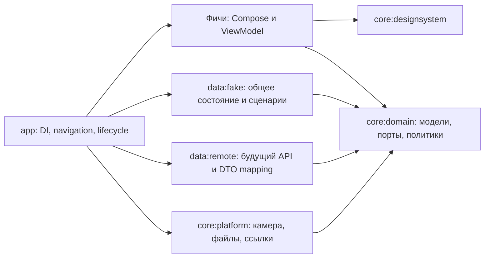

# Модель прав и архитектура

Статус: целевая архитектура. В T01 реализованы пять минимальных модулей и один demo-срез Route/Screen/ViewModel/repository/DI; предметные модели и сценарии ниже ещё не реализованы. Проверка каркаса — `15-t01-validation.md`.

## Архитектурный стиль

**MVVM:** Compose View → ViewModel с неизменяемым UiState/StateFlow → repository/use case → доменные данные. Обновлённый UiState возвращается в View. Практические соглашения по Route/Screen, событиям, ошибкам и coroutine lifecycle — в [правилах реализации](14-engineering-rules.md). Это один общий шаблон, без обязательного BaseViewModel и use case на каждый метод.

## Модель предметной области

Это логическая модель, не обещание структуры backend-таблиц. По B02 от 27 октября гостевая регистрация содержит email и может не иметь userId; она не создаёт User. После самостоятельной регистрации аккаунта backend выдаёт ему билеты на этот email. Клиент использует ответ observeMyTickets и не выполняет привязку по произвольной строке самостоятельно.

| Сущность | Минимально необходимые поля и ограничения |
|---|---|
| User | userId, displayName, email, emailVerified, phone?, organization?, notificationPreference; без global role |
| Session | Anonymous / Authenticated(userId); pending verification отдельно от полной сессии |
| Event | eventId, ownerId, title, description?, cover?, startsAt, endsAt?, zoneId, venue, capacity, lifecycle, registrationOpen, formVersionId, publicSlug |
| EventLifecycle | Draft / Published / Finished / Cancelled; Finished по действию владельца либо endsAt; после startsAt новые регистрации закрыты |
| Registration | registrationId, eventId, userId?, attendeeEmail, formVersionId, answers, consent, status; билет может предшествовать аккаунту; уникальность действующего участия обеспечивает backend |
| Ticket | ticketId, registrationId, displayNumber, opaqueToken, Active/Used/Cancelled |
| VolunteerGrant | eventId, userId, grantedBy, grantedAt, revokedAt?; один активный grant на пару |
| CheckIn | checkInId, ticketId, eventId, checkedBy, checkedAt, checkpoint?; один успешный проход на билет |
| FormVersion / Question / Answer | стабильные ID вопросов и вариантов; типизированные значения; версия не теряет старые ответы |
| GuestTicketSnapshot | компактные данные билета и QR из успешного submit; только в saved state гостевого flow, без постоянного guest cache или доступа к списку билетов |

`displayNumber` и `opaqueToken` различаются. Ручной ввод displayNumber допускается только как явно согласованный контракт Q11. `endsAt` завершает событие, если задан; без него требуется действие владельца. Timezone и формат времени уточняются при интеграции. PendingRegistration исключён по B04; гостю доступен только временный GuestTicketSnapshot из результата заявки, не произвольное чтение билетов.

Не смешивать `capacity` (общий лимит) и `remainingPlaces` (оставшиеся места). Для domain различать Unlimited и Limited(nonNegativeCount); Limited(0) — мест нет. Отсутствующий/не загруженный ответ API означает Unknown/Loading, а не безлимит и не разрешение регистрации. Маппинг серверного null/0 фиксируется при интеграции, клиент сам остаток не распределяет.

## Доступ: совокупность независимых возможностей

`EventAccess` вычисляется по текущему пользователю и конкретному мероприятию. Например: `canRegister`, `canViewOwnTicket`, `canManage`, `canScan`, `canViewAttendees`, `canExport`, `canManageVolunteers`. UI не выбирает одну «самую высокую» роль.

| Действие | Гость | Вошёл без связей | Участник E | Волонтёр E | Владелец E |
|---|---|---|---|---|---|
| Читать опубликованную страницу E | Да | Да | Да | Да | Да |
| Зарегистрироваться на E | Гостевой путь | Да | Открыть имеющийся билет | Как обычный пользователь | Как обычный пользователь, без автоматической выдачи билета (временное Q02) |
| Свой билет E в приложении | QR из результата заявки, пока сохранён гостевой flow; после закрытия — письмо/вход | Если билет есть на email аккаунта | Да | Только при своей регистрации | Только при своей регистрации |
| Создать своё мероприятие | После входа | Да | Да | Да | Да |
| Сканировать E | Нет | Нет | Нет | Да | Да |
| Дашборд, участники, экспорт E | Нет | Нет | Нет | Нет | Да |
| Редактировать E, выдавать/отзывать права E | Нет | Нет | Нет | Нет | Да |

Колонки обозначают отдельные связи. При наличии и билета, и grant возможности объединяются. Отзыв grant не отменяет билет. Отмена билета не отзывает grant. Все операции над закрытыми данными проверяются в репозитории/fake backend и затем на настоящем сервере, даже при прямом вызове в обход UI.

### Обязательный демонстрационный сценарий

Один пользователь `u-alex` владеет E-A, имеет grant на E-B, билет на E-C и одновременно билет + grant на E-D. Для E-A доступны управление и сканирование; E-B — сканирование; E-C — только свой билет; E-D — оба независимых действия. Отзыв grant E-D оставляет билет E-D и все связи A/B/C. Другая сессия не получает кэш предыдущего пользователя.

## Слои и зависимости

Стрелки — зависимости исходного кода. `data:remote` создаётся при интеграции API, а не как пустой набор HTTP endpoints сейчас. `app` выбирает ровно одну data-реализацию на вариант сборки.

Начальная структура — **5 Gradle-модулей**, без модуля на каждый экран:

| Модуль | Владение |
|---|---|
| `:app` | Activity, Application, DI bindings, navigation; пакеты `feature/auth`, `event`, `tickets`, `my-events`, `editor`, `checkin`, `dashboard`, `volunteers`, `profile` |
| `:core:domain` | Чистый Kotlin: ID, модели, интерфейсы репозиториев, EventAccessPolicy, сложные use cases |
| `:core:designsystem` | Theme, токены, общие визуальные компоненты и previews; не знает репозитории |
| `:core:platform` | Android-адаптеры камеры, файлов, буфера и ссылок; реализации портов |
| `:data:fake` | Stateful fake, fixtures, управление временем/ошибками, demo storage |

Переход к отдельным feature-модулям — только при реальной необходимости независимой разработки/времени сборки. Пакеты сразу разделены по функциям, поэтому такой переход не потребует смены доменной модели. Не создавать абстрактный BaseViewModel или use case для каждого простого getter.

## Состояние и события

- Compose получает неизменяемый `UiState` и callbacks. ViewModel управляет `StateFlow`; сбор состояния учитывает lifecycle.
- Репозиторий — единственный источник билетов, прав и счётчиков. Изменение данных возвращается всем подписчикам через Flow, а не вручную через несколько ViewModel.
- Сложные сценарии (`ResolveEventAccess`, `SubmitCheckIn`) могут иметь use case в domain. Простое чтение списка — напрямую через интерфейс репозитория. CompletePendingRegistration не реализуем.
- `SavedStateHandle`/сохранённый back stack — для ID выбранного билета, вкладки, поискового запроса и черновика редактора события. Ответы регистрационной анкеты перед входом не сохраняем; не помещать большие объекты или токены в route.
- Исключение для уже выданного гостевого билета: GuestTicketSnapshot с текстовыми данными/QR payload в SavedStateHandle владельца гостевого flow, связанном с saved instance state Activity. Не сохранять Bitmap/полный JSON API, не писать snapshot в постоянный клиентский cache. Пока flow в стеке, возврат восстанавливает QR; закрытие/удаление flow очищает его. Пересоздание Activity и восстановление той же Android-задачи не являются явным закрытием. Новый запуск после закрытия задачи не открывает гостевой билет.
- Пароли не сохранять в дисковые drafts, SavedState или логах. При восстановлении после смерти процесса пароль вводится снова.
- Snackbar может быть кратковременным effect. Значимые результаты (создан билет, разрешён проход) сохраняются как состояние/ID результата, чтобы не пропасть при смене lifecycle.
- Выход: очистить приватный back stack, пользовательский кэш и pending actions; отменить подписки и pending запросы. Ответ старой сессии не должен попасть в новую.

## Ошибки и конкурентность

Типизированные ошибки: Validation(fieldErrors), Unauthenticated, EmailUnverified, Forbidden, NotFound, CapacityReached, RegistrationClosed, AlreadyRegistered, StaleForm, Conflict, RateLimited(retryAfter), Network, Timeout, Unknown. Бизнес-ответы сканирования не смешивать с transport failure.

Места распределяет сервер. Android блокирует повторное нажатие во время запроса и показывает его результат, включая CapacityReached; реализацию и конкурентные тесты серверной регистрации в Android не включаем. Fake достаточно последовательно выдавать настроенные исходы. Для сканера сохраняем запрет повторного зачёта Used; детали requestId и повторов сетевого запроса подключаются только по реальному API-контракту.

Локальная политика доступа управляет интерфейсом, но не является защитой сервера. Для неизвестного/другого eventId не возвращать чужие данные билета. Серверный Forbidden всегда сильнее локального grant.

## Хранение и границы офлайна

Для первых unit tests достаточно памяти. До ручной приёмки T02 fake получает сохраняемый локальный snapshot и Reset demo, чтобы сценарии переживали перезапуск. Все пользователи fake существуют только локально: второй телефон не увидит изменения первого.

DataStore — настройки и demo snapshot через адаптер; Room не вводить до требований к большому кэшу/пагинации. Production session storage — отдельный порт, решение после auth-контракта; не переносить demo-пароли/токены в реальную реализацию.

Офлайн разрешено показать ранее сохранённый собственный билет с отметкой актуальности. Разрешать проход или выдавать новый билет при отсутствии backend-связи нельзя. Стабы работают локально по определению, но сценарий Offline должен имитировать эти ограничения. Оптимистичное изменение статуса на Used до подтверждения запрещено.
