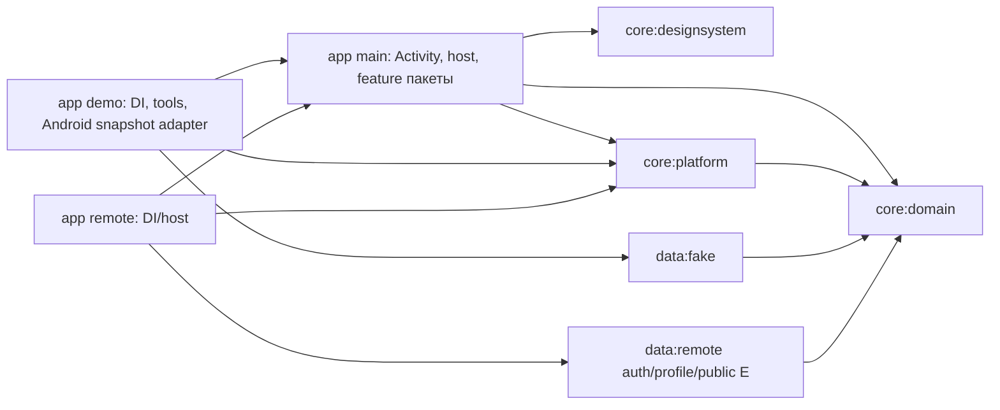
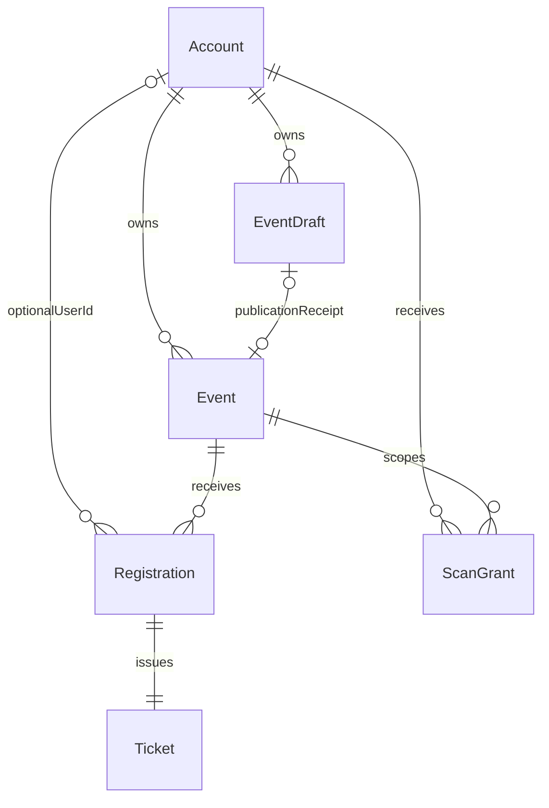

# Фактическая архитектура EventPass Android

**17 ноября — M06 IMPLEMENTED/COMPILE_VERIFIED; поведение NOT_VERIFIED.** Remote Scanner/check-in и Volunteers подключены к существующим UI/ports. [Архитектура M06](architecture/t10-scanner-volunteers.md), [compile и ограничения](validation/t10-m06-implementation.md). Переход без ревью M05 разрешён пользователем; M05/M02 не TECH_ACCEPTED. Одна remote Kotlin/Java/DI компиляция прошла, сценарии/lint/demo/staging/APK/device не запускались. M07–M09 TODO; ручная приёмка после M09.

Целевая адаптация к принятым серверным правилам описана в [34: ADR-T10-01–07 и M00–M09](34-api-migration-plan.md). M01 auth/profile уже реализован, M02 реализован и ожидает отдельного ревью; M03 TECH_ACCEPTED по подтверждению пользователя; M04 принят пользователем; M05 реализован с ограниченной проверкой, M07–M09 ещё не выполнены. Ниже product-поведение demo вне auth; его старые verify/form/lifecycle ограничения не являются новыми требованиями к remote. Обновлять соответствующие разделы вместе с кодом каждого M.

Текущий срез M01–M06: remote auth/profile, public GET, registration/tickets/PDF, owner editor/scoped MyEvents/covers и общие модели/renderer. M07–M09 недоступны в remote, demo product adapters/schema6 сохранены. [M04](architecture/t10-editor-covers.md). Прежняя demo-приёмка не является финальной приёмкой T10.

## Модули и зависимости исходников

`app main`/`app demo` — source sets **одного** Gradle-модуля, не два модуля. Прямая зависимость `app → data:fake` объявлена только demoImplementation. Точные declarations — [app](../app/build.gradle.kts), [platform](../core/platform/build.gradle.kts), [fake](../data/fake/build.gradle.kts), [domain](../core/domain/build.gradle.kts), [designsystem](../core/designsystem/build.gradle.kts).

- MVVM: Route → ViewModel → repository/domain → UiState → Screen. Use case только при сложной/повторной координации; BaseViewModel отсутствует и не требуется.
- Hilt выбирает реализации в [DemoModule](../app/src/demo/kotlin/ru/eventpass/app/di/DemoModule.kt). UI не знает concrete fake/DTO/storage.
- Domain и fake — Kotlin/JVM; platform/designsystem/app — Android. Domain не зависит от Android/Hilt/Compose.
- M01: demoDebug и remoteDebug, release отключён. Remote auth/profile работает через data:remote; public EventRepository реализован в M02, остальные product ports — FeatureUnavailable. Fake/tools/gallery отсутствуют в remote runtime/APK. [Точные владельцы и acceptance](architecture/t10-session-transport.md).
- Фичи auth/event/tickets/myevents/editor/checkin/volunteers/dashboard/profile/documents и demo/gallery — пакеты app. Profile и документные действия подключены; deletion/Q10 отложен. Core platform даёт links/QR/cover/PDF/XLSX/ContentResolver streams и CameraX preview/analyzer, без repository/решения о проходе.

Контракты/state/persistence T07 — [независимая основа T07](architecture/t07-checkin-foundation.md). Реестр значимых классов, их ограничения и точки изменения — [responsibilities](architecture/responsibilities.md).

## Предметные связи реализованного среза

Это связи локальной domain-модели, не структура backend tables. Account — id/email/emailVerified; имя/proof/challenges fake хранит отдельно в AuthData. У guest Registration userId может отсутствовать. Собственные tickets выдаются repository по email подтверждённой текущей сессии, не клиентской привязкой произвольного email. Повторные регистрации после cancel возможны, но действующий билет один.

Вопросы встроены в Event и типизированы в десять форматов. nullable localSchemaRevision/revision существуют только у fake, remote не выдумывает отсутствующие server preconditions. Registration содержит typed answers и optional исторический questionSnapshot; первые CheckInRecord входят в общий snapshot. ScanGrant содержит eventId/userId/active и меняется owner-only VolunteerRepository. CheckInRepository переводит Active → Used и сохраняет первый CheckInRecord; ScannerViewModel связывает прежний ScannerController с Route и platform камерой.

| Модель | Ответственность / инвариант |
|---|---|
| Event | Валидная опубликованная модель; title/time/zone/venue, capacity, lifecycle/registrationOpen, questions/localSchemaRevision (remote null), metadata/cover/revision |
| EventFields / EventDraft | Неполные редактируемые данные; owner/revision и publication receipt отдельно от валидного Event |
| Registration | Email/optional userId, contact/answers/consent/time/questionSnapshot; история сохраняет факт первого участника |
| Ticket / GuestTicketSnapshot | Server билет/status и компактный snapshot выдачи; guest UI lifetime отдельно от server persistence |
| ScanGrant | Независимая связь на E, не глобальная роль; owner grant/revoke в общем store |
| CheckInRecord / QrToken / ManualCode | Первый проход и отдельные typed credentials; legacy Used без record не получает выдуманную историю |
| EventCover | Opaque managed asset descriptor, не path/Bitmap/bytes |
| Profile / DocumentSnapshot | Изменяемые поля отдельно от Account; Авторизованный immutable export snapshot, transient session generation |
| Session / SessionSnapshot | Auth + generation; remote bearer persist только за TokenStore, не в Session/route; fake session transient |

Источники: [EventModels](../core/domain/src/main/kotlin/ru/eventpass/core/domain/event/EventModels.kt), [EventEditing](../core/domain/src/main/kotlin/ru/eventpass/core/domain/event/EventEditing.kt), [registration](../core/domain/src/main/kotlin/ru/eventpass/core/domain/registration/RegistrationModels.kt), [auth](../core/domain/src/main/kotlin/ru/eventpass/core/domain/auth/AuthRepository.kt).

## Права и бизнес-границы

- Один аккаунт, независимые ownership/grant/ticket. Capabilities вычисляются EventAccessPolicy для eventId; не выбирать одну «самую сильную роль».
- Public EventDetails доступен по ссылке после публикации. Draft/editor защищены owner guard в read и mutation; UI-кнопка не является защитой.
- canScan исполняется CheckInRepository и scanner UI; owner AttendanceRepository читает список/summary и отменяет registration; owner export выполняет DocumentsRepository, перед передачей файла повторяет доступ.
- LIVE регистрация разрешена. effectiveEndsAt = endsAt либо start+4h; ручное finishedAt завершает событие. Public remote использует status/counts сервера, не локальный Clock. CloseRegistration удалён из порта/UI.
- Published capacity строго положительная, null допустим у неполного draft. Remaining в public response определяется server counts; ошибка не является Unlimited. Сервер окончательно распределяет места.
- Вопросы редактируются после регистрации, исторические ответы не переписываются. Совместимые local answers сохраняются по stable ID/type/options, несовместимые объясняются; локальная смена questions не аннулирует принятый submit. Fake revisions не обещают server lost-update protection (ADR-T10-06).

Продукт — [01](01-product.md)/[12](12-backend-answers-2026-10-27.md), доступ/проверки — [invariants](architecture/invariants.md). Сроки жизни не следуют из ER-связей: см. [state ownership](architecture/state-ownership.md).

## Что существует, что остаётся планом

| Область | Текущая реализация | Будущее |
|---|---|---|
| Данные | Один FakeProductState, StateFlow/Mutex, полный schema 6 snapshot, AtomicFile adapter | M03–M05 remote adapters / Room draft schema1, остальные M06–M09 |
| UI | Auth, common E/форма/guest QR/manual, Tickets, MyEvents/editor/cover/publish, Volunteers/Scanner/Dashboard, Profile и SAF documents | Remote M03–M09 и единая финальная ручная приёмка |
| Связность | Внутри одного процесса/сохранённых demo-данных | Синхронизация между телефонами требует backend |
| Offline | Управляемый локальный fake; Network/Timeout как отдельные сценарии | Проверенный production cache/remote recovery не реализованы |

Перенос на backend меняет adapters/DI/DTO mapping и session protocol; совместимость ports/UI нужно проверять по реальному контракту, а не обещать замену одной строки URL. Текущие demo passwords/token generation/storage не production solution.

## Поддерживающие карты

- [Ответственность](architecture/responsibilities.md): кто владеет чем и куда вносить изменение.
- [Lifecycle](architecture/state-ownership.md): память, saved state, disk, logout/flow close.
- [Операции](architecture/operations.md): guest submit, login/logout, save/publish и commit.
- [Инварианты](architecture/invariants.md): правила → реализация → test, с границами доказательств.
- [03](03-navigation.md) и [05](05-data-contracts.md): фактические маршруты и контракты хранения.

Прежняя целевая спецификация сохранена [в истории](history/2026-10-30-architecture/README.md); новые изменения вносятся в актуальное описание, а не добавляют над ним ещё одну датированную версию.

## Обновление видимого экрана T09a

Общий EventPassRefresh в core:designsystem рисует gesture/indicator/semantics без domain/navigation/repository. Конкретный Route связывает read своего entry VM и resource, initial/lifecycle/manual single-flight согласованы через visible + RESUMED и поколения. Общий store/schema/модули прежние; ProfileRepository.refreshProfile и VolunteerRepository.refreshVolunteers — минимальные read-порты, без команд/HTTP. [Адресное обновление T09a](architecture/t09a-refresh.md).

## Публичная идентичность M02

EventSlug/PublicEventReference отделены от внутренних EventId. Remote GET кодирует ровно один segment; viewer/contact/ticket привязаны к проверенной сессии и очищаются при logout/401. EventRoute/VM сохраняют entry ownership и visible/RESUMED. Unknown question type блокирует submit, null обязательных published полей — Protocol. [M02 public E/schema6](architecture/t10-public-event.md).

## M04–M05: owner editor, Room и обложки

RemoteEventRepository оставляет public reads и делегирует draft-операции LocalDraftRepository; RemoteOrganizerRepository обслуживает server MyEvents и online published edit/finish. data:local — Android Room library без HTTP/DTO; domain DraftStore задаёт узкую границу. App/remote DI открывает private noBackup DB и связывает auth purge, managed files и coordinator. В demo Room не подключён.

EventDraft.local ID, remoteEventId и slug различаются. DraftStore хранит account partition, incarnation/storage CAS, confirmed/base/pending, localRevision, неизменную create-команду и pending cover reference. LocalDraftState отличается от серверного успеха; localDrafts не входят в server items/counters. EditorKey.remoteDraftId адресует серверный draft, safe saved metadata сохраняет разрешённый local ID; fields/command восстанавливаются из Room после валидного входа того же account.

Save пишет только на устройство; sync — отдельная foreground команда. Room-транзакции короткие, HTTP/file IO вне них. ACK A сохраняет pending B; logout/deletion fence запрещает позднему ответу создать запись заново. После неизвестного PATCH — GET, затем ack или явный конфликт base/local/remote. Merge сохраняет stable IDs; выбор пользователя сначала локален. Publish/finish online. Pending cover копируется в private durable file, upload descriptor фиксируется до attach; release только после перехода DB/проверки ссылок. GET→PATCH не атомарен без server precondition.

[Таблица состояний, доступ, retention и точки commit](architecture/t10-room-drafts.md). [Проверки и NOT_RUN](validation/t10-m05-implementation.md). M03 registration replay/server list scope не переписаны; их повторные регрессии в M05 не запускались по команде пользователя.

## M06: scanner и волонтёры remote

RemoteCheckInRepository / RemoteVolunteersRepository подключены через app/remote DI к общим Scanner/Volunteers. Domain получил sparse receipt/ScannerInfo, memory-only ScanCommand и Volunteer metadata; новых модулей/Room schema нет. [Границы и authority](architecture/t10-scanner-volunteers.md).
