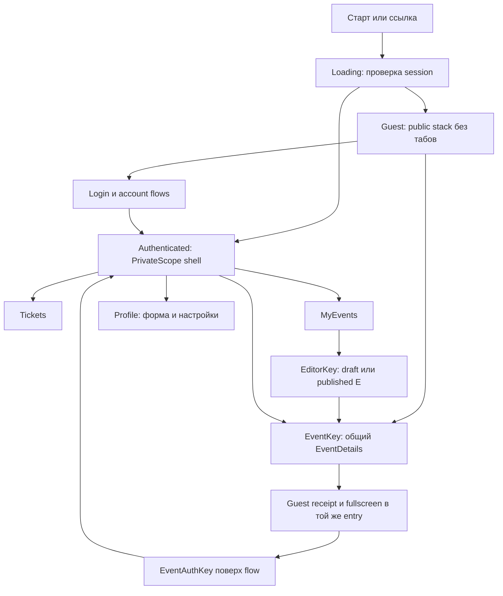

# Текущая навигация и mobile-frame

Remote использует три независимых стека общего NavigationState и общие экраны. Tickets — корень, MyEvents открывает Editor/Dashboard/Scanner/Volunteers по internal ID, public Event — по slug. Profile редактируется в своём корне. TicketKey, открытый из E, закрывается обратно к E. Выбор билета в корне возвращается к списку. В Tickets и Events открыть публичное мероприятие можно из меню «+». В remoteDebug это меню также открывает выбор PDF. Список импортированных билетов доступен из Tickets. Guest capability отсутствует в NavKey. [Проверки текущей сборки](06-delivery-plan.md).

**Целевые auth/guest links после решения 13 ноября:** применять [32](32-backend-final-requirements.md): server slug/web links, immediate signup session и setup/reset по ссылке. Ниже — фактически реализованная demo-навигация; она ещё не адаптирована. Прежние обязательные VerifyEmail/code-reset маршруты не являются требованием к новому backend.

База UI — `c569152` (T01–T06); текущие правила Back уточнены в [исправлении code 13](23-navigation-back-validation.md). Источники: [NavigationState](../app/src/main/kotlin/ru/eventpass/app/navigation/NavigationState.kt), [AppHost](../app/src/demo/kotlin/ru/eventpass/app/navigation/AppHost.kt), [PrivateShell](../app/src/demo/kotlin/ru/eventpass/app/navigation/EventPassApp.kt). Состояние/owners — [отдельная карта](architecture/state-ownership.md).

## Реализованные routes и host

| Ключ / состояние | Размещение и назначение |
|---|---|
| LoginKey / SignUpKey / VerificationKey / ResetKey | Public stack; auth flow VM, без нижних табов |
| RootTab Tickets/Events/Profile | PrivateScope shell, отдельный stack/parent owner на таб; Profile: read/edit/save/notification preference/copy ID/logout; dirty Back/tab leave |
| EventKey(eventId, flowId, publicSlug?) | Public/private common EventRoute; отдельный UUID flow на новый визит |
| EventAuthKey(flowId, screen, entryId) | Public auth поверх E/receipt; связывает возврат с flow, не несёт secret/анкеты |
| EditorKey(draftId/eventId/create/entryId) | Private Events stack, owner read/commands; create нормализуется host к draft ID |
| DashboardKey(eventId,entryId) | Owner-only private entry в исходном табе; query/PII/страницы/confirmation только память |
| ScannerKey / VolunteersKey | Private entry owner; current-tab открытие из общего MyEvents, доступ перепроверяет repository |
| GalleryKey / DemoDetails / DemoToolsKey / OutboxKey | Технические demo routes; gallery/tools/outbox implementation в src/demo |
| GuestReceipt / fullscreen / publication result | **UiState внутри владельца**, не отдельные сериализованные NavKey |
| selected issued ticket | Shell передаёт ID в Tickets VM, выбор меняется на одном экране; системный Back снимает выбор и возвращает список текущего сегмента |

ScannerKey(eventId, entryId) и VolunteersKey(eventId, entryId) находятся в исходном private табе. Result — состояние того же ScannerViewModel, без отдельного result key. Permission/credential/PII/Admitted не сериализуются. DashboardKey подключён: MyEvents owner → Dashboard → те же Scanner/Volunteers → Back в Dashboard с тем же E/query. PDF/XLSX используют SAF ActivityResult из прежних Tickets/Dashboard owners; новых NavKey нет; [lifecycle T07](architecture/t07-ui-lifecycle.md).

## Back, вкладки и возврат

- У guest первый запуск без ссылки — Login/SignUp и подсказка открыть E. Public E и demo tools доступны без private tab shell.
- Обычный успешный Login → Tickets; ReturnDestination.Event/Root возвращает к допустимому назначению один раз на PrivateScope. Анкета/CompleteRegistration отсутствуют. RequiresLogin очищает ответы до перехода; после входа форму заполняют заново.
- Back из auth overlay до смены session scope возвращает к сохранённому guest receipt. Успешный Login переключает host, кабинет получает билеты из repository.
- Receipt/fullscreen принадлежат одной EventKey. Back сначала выходит из fullscreen; явное закрытие удаляет receipt/flow. Новая entry не наследует snapshot удалённой.
- Карточка своего билета — состояние root Tickets, не отдельная NavEntry. TicketsRoute обрабатывает системный Back через `select(null)`, очищая сохранённый ticket ID и сохраняя current/history. Fullscreen QR и диалог отмены обрабатывают Back своим окном: сначала закрывается окно, затем карточка. На списке корневой Tickets обработчик выключен, действует системный выход.
- `NavigationState.openEvent` для внутренних действий добавляет EventKey в текущий стек без смены вкладки и удаления родителя. MyEvents → E → Back возвращает тот же список/сегмент; editor → E → Back — тот же editor/result; ticket → E → Back — выбранный билет. Повтор одинакового верхнего E не добавляет entry.
- Внешняя ссылка и ReturnDestination.Event после входа используют `openLinkedEvent`: отдельный вход через Tickets, с прежними dedup/reset правилами. Другие стеки при этом остаются; внешний вход не подменяет контекст внутренних кнопок.
- Три private стека декорируются и при скрытых табах. `RootTabNavDisplay` меняет отображение сразу при выборе вкладки и при смене общей шапки на собственную шапку PDF. Уходящий экран не успевает получить отступы нового экрана. Состояние записи хранится в декорированном стеке вкладки. Повтор текущего таба возвращает к root, а editor перехватывает Back/reselect с dirty save/discard/stay. Обычное переключение табов сохраняет editor entry.
- Editor сохраняет черновик явно; публикация/result/copy/share не создают новый stack на каждую композицию. Все поля чужого editor закрыты repository read guard.
- Logout/expiry/смена сессии очищают root/hidden ViewModel stores и private saveable state. Старый saved route не доказывает права. Начальное Unknown → Guest не должно удалять публичный registry с восстановленным receipt.
- Forbidden — сообщение и удаление недоступной текущей поверхности по host policy, не бесконечный Login. Unauthenticated — Login с безопасным назначением; repository самостоятельно защищает данные.

Profile root перехватывает системный Back, выбор таба, logout/demo tools при dirty: Save/Discard, dismiss возвращает редактирование. Несохранённые поля только в памяти, hidden/background их очищает. Documents picker хранит безопасный launch ID, transient request остаётся в VM; после нового процесса late result игнорируется. Подробности — [T09 lifecycle](architecture/t09-profile-files.md).

## Ссылки и доставка

| Allowlist | Обработка |
|---|---|
| `eventpass-demo://demo/e/{eventId}` | AuthDemoLinkParser → OpenLink → public/private общий E; отсутствующий E показывает NotFound |
| `eventpass-demo://demo/confirm/{challengeId}?token=...` | Только demo: AuthLinkHandler → completeEmailLink → сообщение; verify сохраняет существующую session |
| `eventpass-demo://demo/{recordId}` | Legacy DemoLinkParser → технический счётчик, не продуктовый ticket lookup |

Cold ACTION_VIEW и onNewIntent идут через Activity VM; URI/token не сериализуются в route/SavedStateHandle. Поворот сохраняет временную очередь в Activity VM; process death не обещает восстановление секрета доставки. RequestId различает текущую доставку/retry; inFlight/handled защищают параллельную/успешную повторную обработку, failure можно повторить явно. Успешное повторное открытие E не создаёт дубль одинакового верхнего flow; public host также умеет вернуться к уже существующему flow.

Remote M01 игнорирует ACTION_VIEW и очищает secret URI. App Links отложены; setup/reset/verify выполняются browser; при возвращении /me перечитывается, смена пароля требует login. Demo verify только в demo flavor; code/grant шаги удалены. Произвольный returnUrl/host/role не является разрешённым маршрутом. Точные ограничения parser — в [AuthDemoLinkParser](../core/platform/src/main/kotlin/ru/eventpass/core/platform/AuthDemoLinkParser.kt) и [DemoLinkParser](../core/platform/src/main/kotlin/ru/eventpass/core/platform/DemoLinkParser.kt).

## Реестр 18 mobile-frame — продуктовый ориентир

G01–G05/P01/P02 и O01/V01/O02/O03 представлены текущим срезом с изменениями B02/B04. P03 — профиль с dirty/save/discard и настройкой напоминаний; remote deletion подключён в M08, legacy demo deletion недоступен. V02–V05/O05 подключены в T07, O04 подключён в T08; обе camera/UI и общая H3 ждут человека. Упомянутый будущий route в таблице не означает наличие реализации.

Все ссылки ведут в один файл. «Состояние» означает переиспользование одного экрана, а не отдельную фичу.

| Код | Сценарий / Figma | Реализация и выход |
|---|---|---|
| G01 | [Страница гостя, 28:175](https://www.figma.com/design/i2NNhWGwunnvhZZX3GPuSR/Untitled?node-id=28-175) | EventDetails с guest-формой → G02/G03 |
| G02 | [Гостевой билет, 51:193](https://www.figma.com/design/i2NNhWGwunnvhZZX3GPuSR/Untitled?node-id=51-193) | GuestTicketReceipt: QR + сообщение о письме; saved state flow для возврата, без автосозданного аккаунта/постоянного гостевого кабинета |
| G03 | [Email существует, 51:284](https://www.figma.com/design/i2NNhWGwunnvhZZX3GPuSR/Untitled?node-id=51-284) | Login с email и return eventId; ответы не сохраняем, после входа заново заполнить форму |
| G04 | [Вход, 28:50](https://www.figma.com/design/i2NNhWGwunnvhZZX3GPuSR/Untitled?node-id=28-50) | Login → pending destination или P02 |
| G05 | [Регистрация аккаунта, 28:93](https://www.figma.com/design/i2NNhWGwunnvhZZX3GPuSR/Untitled?node-id=28-93) | SignUp → VerifyEmail → ручной Login → нужный маршрут |
| P01 | [Страница участника, 28:257](https://www.figma.com/design/i2NNhWGwunnvhZZX3GPuSR/Untitled?node-id=28-257) | Тот же EventDetails, данные профиля, только вопросы → P02 |
| P02 | [Мои билеты, 14:8394](https://www.figma.com/design/i2NNhWGwunnvhZZX3GPuSR/Untitled?node-id=14-8394) | Tickets(selectedTicketId, tab); выбор другого билета на месте |
| P03 | [Профиль, 28:409](https://www.figma.com/design/i2NNhWGwunnvhZZX3GPuSR/Untitled?node-id=28-409) | Profile; возврат на E без сохранения ответов анкеты |
| V01 | [Волонтёрские мероприятия, 29:96](https://www.figma.com/design/i2NNhWGwunnvhZZX3GPuSR/Untitled?node-id=29-96) | MyEvents(tab=Volunteer) → V02 |
| V02 | [Камера, 29:243](https://www.figma.com/design/i2NNhWGwunnvhZZX3GPuSR/Untitled?node-id=29-243) | Scanner(eventId), камера или ввод → V03/V04/V05 |
| V03 | [Разрешён, 29:289](https://www.figma.com/design/i2NNhWGwunnvhZZX3GPuSR/Untitled?node-id=29-289) | Состояние ScanResult: Admitted |
| V04 | [Использован, 29:336](https://www.figma.com/design/i2NNhWGwunnvhZZX3GPuSR/Untitled?node-id=29-336) | Состояние ScanResult: AlreadyUsed |
| V05 | [Недействителен, 29:375](https://www.figma.com/design/i2NNhWGwunnvhZZX3GPuSR/Untitled?node-id=29-375) | Состояние ScanResult: Invalid |
| O01 | [Свои мероприятия, 29:558](https://www.figma.com/design/i2NNhWGwunnvhZZX3GPuSR/Untitled?node-id=29-558) | Тот же MyEvents(tab=Owned) → O02/O04/V02 |
| O02 | [Создание, 17:9426](https://www.figma.com/design/i2NNhWGwunnvhZZX3GPuSR/Untitled?node-id=17-9426) | EventEditor(eventId?) → Drafts / O03; тот же экран редактирует |
| O03 | [Опубликовано, 29:664](https://www.figma.com/design/i2NNhWGwunnvhZZX3GPuSR/Untitled?node-id=29-664) | PublicationResult(eventId) → O04/O05 |
| O04 | [Дашборд, 29:950](https://www.figma.com/design/i2NNhWGwunnvhZZX3GPuSR/Untitled?node-id=29-950) | DashboardKey(eventId,entryId) → существующие O05/V02; экспорт скрыт до T09 |
| O05 | [Волонтёры, 29:833](https://www.figma.com/design/i2NNhWGwunnvhZZX3GPuSR/Untitled?node-id=29-833) | Volunteers(eventId), grant/revoke |

## Не переносить устаревшее из макетов

Нет автосоздания аккаунта, сохранённой анкеты перед Login, кнопки «войти и завершить регистрацию», каталога/оплаты/Wallet/MAX/архива. G02 сохраняет немедленный QR и сообщение о письме, но постоянного guest кабинета нет. Android не показывает «открыть в приложении» и браузерные инструкции разрешения камеры.

Scanner Result Back → ready, затем Back → прежний родитель. Top bar и system Back согласованы. Hidden tab/background/logout/revoke останавливают анализ и удаляют result; denied возвращает MyEvents с сообщением. Физическая camera/UI приёмка ожидается; текущие инварианты — [карта тестов](architecture/invariants.md). История прежнего route-проекта — [архив](history/2026-10-30-architecture/README.md).

## Обновление видимого экрана T09a

Pull принадлежит текущей видимой entry: Tickets/list/card, MyEvents/выбранный сегмент, public Event текущего eventId, Dashboard/Volunteers того же E, Profile. Tickets/MyEvents/Event больше не запускают read из скрытого STARTED owner; host передаёт visible по tab + верхнему ключу, lifecycle — RESUMED. Обновление не меняет стек/parent/выбор/query. Fullscreen/confirmation блокируют underlying gesture; auth/Scanner/guest receipt не получают reload; editor M04 обновляет только свой owner target. SAF pending при configuration change сохраняется по прежнему c75ce56. [Адресное обновление T09a](architecture/t09a-refresh.md).

## Публичный slug в M02

Remote host открывает общий EventRoute через явный импорт HTTPS `/e/{slug}` с allowlist; OS App Links остаются отключены. EventKey/ReturnDestination хранят publicSlug отдельно от internal eventId, без raw URI/token. Remote public/internal references не подменяются друг другом. Observe/refresh только у visible + RESUMED entry; back/dispose останавливает read. Root safeDrawing/IME защищают новые public поверхности. Login возвращает только к безопасному publicSlug, не к сохранённой анкете и не к autosubmit. Private M01 scope уничтожает старые owners; remote own-ticket/action ведёт к TicketKey общего TicketsRoute (M03). Подробный lifetime и constraints — [M02 public E/schema6](architecture/t10-public-event.md).

В M03 выбранная own-карточка может отсутствовать в server scope списка. Она хранится отдельно от server items/counters; Back карточки очищает selection/selectedCard, не добавляя билет в исходный список. Восстановленный ticketSelection запускает собственный observer до ответа списка. Данные QR и status берутся из карточки с её event/now, а не из соседнего списка. [Владельцы и операции](architecture/t10-registration-tickets.md).

## M04–M05: remote MyEvents и EditorKey

Remote shell использует общие MyEventsRoute/EditorRoute. EditorKey.draftId — стабильный localDraftId, remoteDraftId — отдельный server eventId, eventId — published target; public slug используется только для public open/copy/share. RemoteDraft разрешается в сохранённый Room local ID; после recreation безопасный resolved ID хранится у entry, pending поля читаются из account-scoped Room. Unknown create больше не теряет тело при process death: явный sync повторяет сохранённую команду в пределах срока. После cold Auth Recovery данные скрыты до проверенной сессии того же account.

Back save/discard/stay сохраняет текущий raw ввод или отбрасывает только несохранённый ввод; отдельная команда discard persisted удаляет/сбрасывает сохранённый pending. Hidden/background отменяет чтение и foreground sync, configuration change сохраняет живую VM. Pull читает текущий ресурс, без POST. Мои мероприятия показывает local projection отдельно от server items/counters, с устранением визуального дубля по remote ID. [Состояние и права M05](architecture/t10-room-drafts.md). Финальная UI-приёмка после M09; M05 device/UI smoke не запускался.

## M06: remote scanner/volunteers

MyEvents server summary открывает ScannerKey по internal eventId для organizer/volunteer, VolunteersKey для organizer. Remote host подключает прежние ScannerRoute/VolunteersRoute; result не создаёт отдельный NavKey. При отказе route возвращается к родителю с сообщением ScannerAccessLostKey. Visible RESUMED перечитывает доступ; неизвестная отправка сохраняет прежний memory-only key для явного retry, без auto POST при resume. [Lifecycle/Back](architecture/t10-scanner-volunteers.md).

## M07: remote DashboardKey

MyEvents organizer открывает прежний DashboardKey по internal eventId; оттуда — общие Scanner/Volunteers того же E. Back возвращает в Dashboard с query живой VM; visible RESUMED перечитывает согласованный snapshot, скрытый родитель не поллится. Query/selection/PII не persist в SavedState/Room. Отказ очищает private состояние и возвращает сообщение; XLSX до M08 не предлагается. [Владельцы M07](architecture/t10-dashboard-attendees.md).

## M08–M09: корневой профиль и документы

Remote root открывает общий P03 ProfileRoute через ProfileEditKey: email/publicId/notifications и local delete cascade confirmation, без password/demo tools. При204 cleanup переводит в guest и уничтожает private owners;401 сам по себе не сообщение «аккаунт удалён». Unknown предлагает явную me сверку. Profile raw input живёт у VM/recreation; server XLSX включён у Dashboard и использует прежний SAF owner. Product resend кнопки нет. [Lifecycle/cleanup M08](architecture/t10-profile-delete-documents.md).

## Уточнение стартового remote экрана

LoginKey содержит форму и фиксированную нижнюю кнопку «Ввести ссылку на мероприятие». При IME кнопка скрыта под клавиатурой, вверх не переносится; imePadding применяется к форме. Кнопка открывает AlertDialog с полем, валидацией прежним PublicEventLinkParser и отменой. Cancel/Back/outside закрывают диалог без изменения Login entry/полей; успешный parse открывает прежний EventKey с publicSlug. Signup/reset/public E сохраняют отдельные IME insets.
