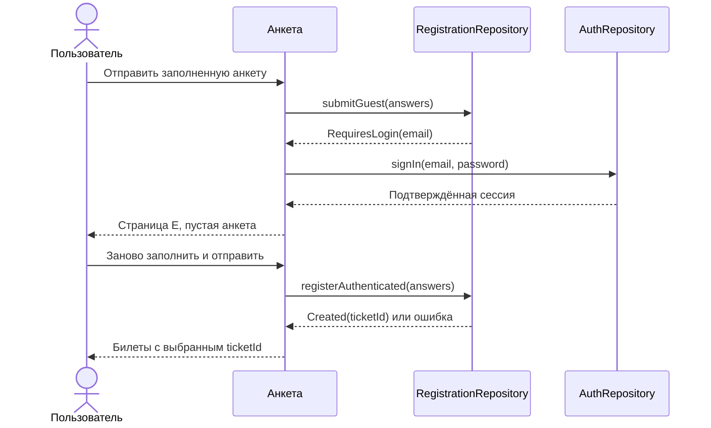

# Экраны, переходы и связи

**T06 foundation, 29 октября:** маршруты приложения не изменены. Корневые «Мероприятия» пока временные; MyEvents/Editor/Published и их route guards не подключены до H2, которую пользователь ещё не проверил. Добавлены только repository-контракты и проверки доступа к данным. Draft/event передаются будущему маршруту по ID; full draft/cover bytes туда не попадут. [Реализованный объём](20-t06-validation.md).

**T05, 29 октября — READY_FOR_HUMAN.** Общий EventRoute/EventScreen для public/private E заменяет EventReceiver. EventKey(eventId, flowId) владеет EventViewModel/GuestReceiptState; fullscreen — состояние того же owner, без payload в route. EventAuthKey хранит только flowId/screen/entryId и оставляет receipt под auth для Back. Повтор E-ссылки возвращает к существующему flow. Tickets root показывает свои билеты/выбор/историю/отмену и fullscreen без табов. Unknown → Guest сохраняет публичный registry, private stacks остаются под session gate. T04 auth smoke принят человеком, H2 ожидается. [Сборка и H2](19-t05-validation.md).

Актуализировано по [ответам от 27 октября](12-backend-answers-2026-10-27.md). Исходные frame ID сохраняют трассировку к Figma, но гостевой сценарий изменён пользователем.

**История T04 до ручной приёмки 29 октября (теперь DONE):** H1 подтверждена человеком; Login/SignUp/verification/reset, живой session gate и Activity links подключены. До определения сессии — Loading; Guest — Login без табов; после Login — Tickets либо разрешённое E. Profile показывает email/выход. Три private стека, saveable state и parent ViewModelStore каждого таба отделены PrivateScope; logout/expiry/смена личности уничтожают прежних owners. EventKey — минимальный приёмник ID без анкеты, остальные продуктовые поверхности — T05+. Команды, проверки и auth smoke — [18-t04-validation.md](18-t04-validation.md).

Activity принимает cold/warm `eventpass-demo://demo/e/<eventId>` и `/confirm/<challengeId>?token=<secret>`. Handler сохраняет inFlight/handled: отказ/отмена допускают явный retry с прежним requestId, успех не исполняется повторно. Transient доставка принадлежит Activity ViewModel, URI очищается из Intent и не сохраняется; поворот обработку не теряет. После подтверждения — Login с email и ручным паролем. Legacy `/demo` открывает технический счётчик также у гостя, без доступа к shell. Реальные домен/App Links и reset-ссылка не добавлены.

## Общая навигация

После обычного входа — «Мои билеты». Авторизованная оболочка: **Билеты · Мероприятия · Профиль**. В «Мероприятиях»: Организую / Волонтёр / Черновики. Отдельного пункта сканера нет. Оболочка гостя без нижних табов; старт без внешней ссылки — Вход с возможностью регистрации и подсказкой открыть ссылку организатора (принято Q14).

```mermaid
flowchart LR
    link["Ссылка на мероприятие"] --> event["Общая страница мероприятия"]
    event --> form["Регистрация с consent"]
    form --> guest["Новый email: временный QR и письмо"]
    guest --> signup["Создать аккаунт самостоятельно"]
    signup --> verify["Подтвердить почту"]
    verify --> ordinary["Войти вручную"]
    form --> login["Существующий email: вход без сохранения анкеты"]
    login --> event
    ordinary --> tickets["Билеты на email аккаунта"]
    form --> tickets
    tickets --- shell["Билеты / Мероприятия / Профиль"]
    shell --> events["Мои мероприятия"]
    events --> owner["Организую"]
    events --> volunteer["Волонтёр"]
    events --> drafts["Черновики"]
    owner --> dash["Дашборд E"]
    owner --> scan["Общий сканер E"]
    volunteer --> scan
    dash --> scan
    dash --> grants["Волонтёры E"]
    drafts --> editor["Общий редактор E"]
    owner --> editor
    events --> editor
    editor --> published["Опубликовано: ссылка"]
    scan --> result["Результат проверки"]
    result --> scan
```



Граф укрупнённый: `form → tickets` относится к авторизованному пользователю, `form → guest` — к новому гостевому email. Развилка определяется результатом отправки, а не отдельной клиентской проверкой существования email.

## Реестр 18 mobile-frame

Все ссылки ведут в один файл. «Состояние» означает переиспользование одного экрана, а не отдельную фичу.

| Код | Сценарий / Figma | Реализация и выход |
|---|---|---|
| G01 | [Страница гостя, 28:175](https://www.figma.com/design/i2NNhWGwunnvhZZX3GPuSR/Untitled?node-id=28-175) | EventDetails с guest-формой → G02/G03 |
| G02 | [Гостевой билет, 51:193](https://www.figma.com/design/i2NNhWGwunnvhZZX3GPuSR/Untitled?node-id=51-193) | GuestTicketReceipt: QR + сообщение о письме; saved state flow для возврата, без автосозданного аккаунта/постоянного гостевого кабинета |
| G03 | [Email существует, 51:284](https://www.figma.com/design/i2NNhWGwunnvhZZX3GPuSR/Untitled?node-id=51-284) | Login с email и return eventId; ответы не сохраняем, после входа заново заполнить форму |
| G04 | [Вход, 28:50](https://www.figma.com/design/i2NNhWGwunnvhZZX3GPuSR/Untitled?node-id=28-50) | Login → pending destination или P02 |
| G05 | [Регистрация аккаунта, 28:93](https://www.figma.com/design/i2NNhWGwunnvhZZX3GPuSR/Untitled?node-id=28-93) | SignUp → VerifyEmail → ручной Login → нужный маршрут |
| P01 | [Страница участника, 28:257](https://www.figma.com/design/i2NNhWGwunnvhZZX3GPuSR/Untitled?node-id=28-257) | Тот же EventDetails, данные профиля, только вопросы → P02 |
| P02 | [Мои билеты, 14:8394](https://www.figma.com/design/i2NNhWGwunnvhZZX3GPuSR/Untitled?node-id=14-8394) | Tickets(selectedTicketId, tab); выбор другого билета на месте |
| P03 | [Профиль, 28:409](https://www.figma.com/design/i2NNhWGwunnvhZZX3GPuSR/Untitled?node-id=28-409) | Profile; возврат на E без сохранения ответов анкеты |
| V01 | [Волонтёрские мероприятия, 29:96](https://www.figma.com/design/i2NNhWGwunnvhZZX3GPuSR/Untitled?node-id=29-96) | MyEvents(tab=Volunteer) → V02 |
| V02 | [Камера, 29:243](https://www.figma.com/design/i2NNhWGwunnvhZZX3GPuSR/Untitled?node-id=29-243) | Scanner(eventId), камера или ввод → V03/V04/V05 |
| V03 | [Разрешён, 29:289](https://www.figma.com/design/i2NNhWGwunnvhZZX3GPuSR/Untitled?node-id=29-289) | Состояние ScanResult: Admitted |
| V04 | [Использован, 29:336](https://www.figma.com/design/i2NNhWGwunnvhZZX3GPuSR/Untitled?node-id=29-336) | Состояние ScanResult: AlreadyUsed |
| V05 | [Недействителен, 29:375](https://www.figma.com/design/i2NNhWGwunnvhZZX3GPuSR/Untitled?node-id=29-375) | Состояние ScanResult: Invalid |
| O01 | [Свои мероприятия, 29:558](https://www.figma.com/design/i2NNhWGwunnvhZZX3GPuSR/Untitled?node-id=29-558) | Тот же MyEvents(tab=Owned) → O02/O04/V02 |
| O02 | [Создание, 17:9426](https://www.figma.com/design/i2NNhWGwunnvhZZX3GPuSR/Untitled?node-id=17-9426) | EventEditor(eventId?) → Drafts / O03; тот же экран редактирует |
| O03 | [Опубликовано, 29:664](https://www.figma.com/design/i2NNhWGwunnvhZZX3GPuSR/Untitled?node-id=29-664) | PublicationResult(eventId) → O04/O05 |
| O04 | [Дашборд, 29:950](https://www.figma.com/design/i2NNhWGwunnvhZZX3GPuSR/Untitled?node-id=29-950) | Dashboard(eventId) → экспорт/O05/V02 |
| O05 | [Волонтёры, 29:833](https://www.figma.com/design/i2NNhWGwunnvhZZX3GPuSR/Untitled?node-id=29-833) | Volunteers(eventId), grant/revoke |

## Типизированные маршруты

Проектируем AppRoute с сериализуемыми ключами. Реализация библиотеки — ADR-03. В аргументах только ID и безопасные enum:

```text
Login(returnDestination?) / SignUp(returnDestination?)
VerifyEmail(flowId) / ResetPasswordRequest / ResetPasswordCode(flowId) / NewPassword(flowId)
EventDetails(eventIdOrSlug)
GuestTicketReceipt(flowId) / FullscreenQr(ticketRef)
Tickets(selectedTicketId?, tab=Upcoming)
MyEvents(tab=Owned) / Profile(returnEventId?)
EventEditor(eventId?) / PublicationResult(eventId)
Dashboard(eventId) / Volunteers(eventId)
Scanner(eventId) / ScanResult(eventId, resultId)
```

`flowId` и `ticketRef` — локальные ссылки, не секреты в route. GuestTicketReceipt и гостевой FullscreenQr читают snapshot из saved state того же flow, полученный при успешном submit. Пока flow сохранён, можно уйти на соседний экран и вернуться к QR. При явном закрытии/удалении flow очищаем snapshot; повторное открытие по одному flowId не загружает билет с сервера без разрешения. После закрытия задачи и нового запуска доступны письмо/кабинет. Подробно о восстановлении Android-задачи — B02 в `12-backend-answers-2026-10-27.md`. Коды auth не сохраняем в route. Гостевой PDF этим уточнением не задан.

## Возврат после входа

Сохраняем только безопасное назначение OpenDestination(route), например EventDetails(eventId). По B04 ответы не переносим через вход, CompleteRegistration/PendingRegistration отсутствуют. После входа на E заполняют форму и нажимают отправку заново. Обычный вход без назначения открывает Tickets. Произвольный returnUrl не является доверенным маршрутом: разбираем допустимые значения и повторно проверяем доступ.



Уточнение B02/B04: гостю сразу показываем QR из результата заявки и сохраняем его в состоянии flow; после закрытия flow — письмо либо кабинет, без автосоздания аккаунта. После входа не завершаем заявку автоматически. После самостоятельного создания аккаунта и входа Tickets показывает все билеты на его email. Подтверждение email возвращает на ручной вход; сброс пароля по коду из письма.

## Back, вкладки и восстановление

- Каждая корневая вкладка сохраняет своё состояние. Повторное нажатие текущего таба возвращает к его корню (предложение, H2).
- Переходы между табами не создают бесконечный стек одинаковых экранов.
- Сканер → результат через замену/единый scan flow; «Сканировать следующий» очищает результат и запускает камеру. Back из результата возвращает к камере; Back из камеры — в исходный список/дашборд. Прямой deep link синтезирует безопасный родитель MyEvents.
- Нижняя навигация остаётся на вложенных экранах, как в mobile-макетах. Полноэкранный QR и auth без нижнего бара. Уход со сканера на другой таб останавливает камеру.
- Черновик редактора мероприятия сохраняется и восстанавливается по draftId. Регистрационная анкета не сохраняется при переходе во вход, уходе с экрана или смерти процесса; не предлагать сохранить её как черновик.
- Forbidden → MyEvents + понятное сообщение, удалить недоступный экран из стека; Unauthenticated → вход с pending destination. При загрузке прав не показывать временно закрытые данные.
- Если root MyEvents сам потребовал вход, успешный вход возвращает туда; стандартный вход без pending → Tickets.

## Android App Links

Публичный путь `/e/{slug}` известен из примера Figma; домен `eventpass.ru` — демонстрационный, контроль домена не подтверждён. Production host, `assetlinks.json`, applicationId и подписи согласовать с backend; до этого debug-ссылки на тестовой схеме и direct launch для ручной приёмки.

Типы ссылок: мероприятие, подтверждение email; ссылка на конкретный билет — только если будет в API, с проверкой входа. Сброс пароля сейчас через код из письма; маршрут сброса по ссылке не добавлять без контракта. Обрабатывать cold start и onNewIntent, истёкшую/повторную ссылку, неверный host, отсутствующее мероприятие и отсутствие прав.

## Недорисованные поверхности

Auth: ожидание письма, повтор отправки с cooldown, задание/сброс пароля. Tickets: история, пустое состояние, отмена, fullscreen QR. MyEvents: пустые вкладки, черновики, прошедшие. Editor: вопрос/варианты/ошибки/несохранённое. Scanner: ручной ввод, permission denied, загрузка, сеть. Dashboard: отмена участника, экспорт/ошибка. Profile: подтверждение выхода/удаления и повторная аутентификация.

Фильтр-иконка на «Мои билеты» и часть служебных значков не имеют поведения в заметках: по принятому Q13 скрыть, не добавлять случайные функции. Внутри Android убрать «Открыть в приложении» и браузерную формулировку разрешения камеры.
