# Текущие порты, fake и хранение

**Срез передачи 15 ноября:** M00/M01 TECH_ACCEPTED, M02 WIP_HANDOFF и ещё без итогового ревью. В коде M02 уже меняются EventRepository/PublicEventReference, типизированные ответы и fake product schema 6 с legacy decoder; описания прежней schema 5 ниже относятся к принятому срезу до M02. При чтении учитывать [актуальный handoff M02](validation/t10-m02-handoff-2026-11-15.md), решения 08/34 и исходники; следующий исполнитель должен синхронизировать затронутые разделы перед REVIEW_PENDING. Наличие описания здесь не подтверждает завершение WIP.

M01 auth/session уже реализован: [фактические ports, ownership, transport и cleanup](architecture/t10-session-transport.md). Остальные ещё не мигрированные product-разделы описывают demo, не remote.

**Уточнение текущего целевого контракта:** после последнего ответа пользователя endsAt по умолчанию = startsAt+4 часа, ticket resend исключён. Перечень для backend — [32](32-backend-final-requirements.md); он не содержит Android-планов. Отдельный будущий offline draft: server snapshot + local pending в Room за repository, явная синхронизация без потери dirty данных; детали решения — в 08. Текущее demo этим документом не меняется.

**Целевой backend после решения 13 ноября — [32](32-backend-final-requirements.md).** Ниже описано фактическое demo, которое пока не переписано: его verified-only/code-reset/guest-without-account/manual-code/freeze/unlimited defaults расходятся с новым целевым поведением. Не требовать возврата backend к старому demo; адаптацию ports/fake/VM выполнять отдельным согласованным срезом. Старое OpenAPI — историческое предложение.

UI T01–T09 demo, общий snapshot schema 5. Это мобильные порты и локальный fake backend, не согласованный REST/OpenAPI. [T09 операции/границы файлов](architecture/t09-profile-files.md), решения — [08](08-decisions.md).

## Реализованные порты

Точные типы/сигнатуры — [ProductRepositories](../core/domain/src/main/kotlin/ru/eventpass/core/domain/ProductRepositories.kt), [AuthRepository](../core/domain/src/main/kotlin/ru/eventpass/core/domain/auth/AuthRepository.kt), [CoverImporter](../core/domain/src/main/kotlin/ru/eventpass/core/domain/event/CoverImporter.kt). Ниже карта, не вторая копия Kotlin-интерфейсов.

| Порт | Чтение | Команды и исходы |
|---|---|---|
| AuthRepository | observeSession/currentSession | refreshSession, signUp/signIn/signOut, requestVerification/requestPasswordReset/completeEmailLink, consentDocuments; AuthResult<Auth Session/EmailDispatch/Unit>, AuthError; SessionState.Recovery |
| EventRepository | observePublicEvent, observeMyEvents, observeEditor | refreshPublicEvent/refreshMyEvents, saveDraft/publishDraft/updateEvent/closeRegistration/finishEvent; typed read/edit outcomes |
| RegistrationRepository | Через event/tickets reads | submitGuest / submitAuthenticated, разные допустимые результаты |
| TicketRepository | observeMyTickets / observeOwnTicket | refreshMyTickets / cancelOwnTicket; own access и typed error |
| AttendanceRepository | owner-only observeDashboard / attendees(revision cursor) | refreshDashboard / cancelRegistration(eventId,registrationId); totals из tickets, без credentials |
| VolunteerRepository | observeVolunteers(eventId), refreshVolunteers(eventId), owner only | grant(emailOrId) / revoke(userId); Updated/typed failure |
| CheckInRepository | observeAccess / refreshAccess | checkIn(eventId, typed credential); Admitted/AlreadyUsed/Invalid/Failed |
| CoverImporter | Не читает repository | importCover(source) → EventCover descriptor либо typed failure |
| EventCoverPreview (platform interface) | Асинхронный preview managed asset | Android decode/EXIF вне domain |

Actor для private операции разрешается по текущей подтверждённой сессии **внутри реализации**. ID в аргументе не даёт доступа. Общие UI/ViewModels получают только порты через DI. Cover source identifier — временный вход platform adapter, а не произвольный path в persisted Event.

## Один общий backend и publish order

```mermaid
flowchart LR
    ports["Repository ports через demo DI"] --> ops["Auth, ticket, editor, grants, check-in и attendance operations"]
    ops --> shared["Initialize и общий Mutex на IO"]
    shared --> proposed["Следующий полный FakeProductState"]
    proposed --> codec["ProductSnapshotCodec schema 5"]
    codec --> atomic["AtomicFile adapter"]
    atomic --> published["StateFlow после успешной записи"]
    published --> observers["Общие event, tickets, editor и attendance observers"]
```

FakeEventPassEnvironment содержит один MutableStateFlow<FakeProductState> и один coroutine Mutex. FakeAuthRepository, FakeTicketOperations, FakeEventEditingOperations, FakeCheckInOperations и FakeAttendanceOperations используют этот же state/lock/storage. ScenarioController — только demo/test, не owner/auth API.

Изображён durable mutation path; refresh/read errors и transient session имеют отдельные пути. Ошибка записи преобразуется в typed storage failure без ложного durable success. Отмена после уже выполненного commit не означает rollback; не обещать, что запись отсутствует, если UI не получил успех. Особая acceptance signIn описана в [operations](architecture/operations.md): session не durable и публикуется на активном caller после отменяемого возврата/ожидания lock.

## Результаты и политики

- Guest: Issued(snapshot/email), RequiresLogin, ExistingRegistration без старого credential, Failed. User не создаётся. Повторный guest submit не является lookup по email/ID. Только результат успешной новой заявки даёт saved guest receipt.
- Auth submit: актор/контакт из сессии, не из доверенного email/userId UI; результат Registered содержит собственный ticketId. После signup/confirm нужен явный Login, список выдаёт прежние билеты на email этого аккаунта.
- Active cancel освобождает место один раз, Used отклоняется; новая заявка после cancel получает новый токен при доступной регистрации. Количество мест выводится из неотменённых tickets; серверную гонку Android не реализует.
- PublicEventResult/OwnTicketResult/MyTicketsResult различают отсутствие/доступ/typed read failure. Error не равен пустому списку или Unlimited. Refresh/observe используют общие данные, не отдельные числа на экран.
- SaveDraft допускает неполные fields; publish валидирует. Owner/current session/revision/formVersion проверяются заново при мутации. История registrations навсегда фиксирует вопросы после первого участника; callback UI не заменяет guard.
- Event metadata update меняет server ticket snapshot title/date/venue/zone, не credential/status. Guest receipt остаётся снимком выдачи. Started metadata допустима по EventEditingPolicy, даты/zone не меняются; terminal update запрещён. Это текущий demo default, не серверный договор.
- Expected errors представлены отдельными семействами AuthError, ProductReadError, RegistrationError, TicketError, EventEditError и CoverImportResult; общего реализованного AppError-framework нет. CancellationException не превращать в Network; UI mapping — resources.

## Profile и документы T09

ProfileRepository.observeProfile/refreshProfile перечитывает профиль; saveProfile меняет name/optional Russian phone/organization/notifications в прежнем store. Identity/email read-only; имя в AuthData.names, детали — profileDetails. Новые RegistrationContact получают name/phone, старые registrations/tickets/checkIns не переписываются. DocumentsRepository.prepare/validate/resendTicket отдаёт typed outcomes и immutable DocumentSnapshot, File port не зависит от Android Uri/Context. PDF только свой current Active, XLSX owner E/all registrations+answers независимо от query/pages, без credentials. VM/Compose не знают fake/DTO. [Исходники и операции](architecture/t09-profile-files.md).

## Persistence и границы хранения

| Что | Где/срок жизни |
|---|---|
| Accounts/proofs/names/auth mail links и полный product state | Один AtomicFile `noBackupFilesDir/demo-auth-v1.bin`; legacy имя сохранено для совместимости |
| Events/registrations/tickets/status/scan grants/phone policy/nextId | ProductSnapshotCodec schema 5; данные fake-сервера |
| Manual codes / first check-in records | Schema 4, в том же server snapshot; UI scanner result не persist |
| Drafts, publication receipts, revisions, cover descriptors | Та же schema 5; сохранённый draft переживает новый процесс |
| Cover bytes | Managed app-private files через AndroidEventCoverStore, не в snapshot/route |
| Session/auth mail/ticket outbox/fail-next/read errors/Clock offsets | Память; новый процесс не восстанавливает их как действующую сессию/очередь писем |
| Незавершённая анкета, raw auth secrets | Не сохраняются в постоянное хранилище/SavedStateHandle |
| Guest receipt | Только SavedStateHandle конкретной EventKey; исключение для временного UI восстановления, не server lookup |

Фактический список полей encode/decode — [ProductSnapshotCodec](../data/fake/src/main/kotlin/ru/eventpass/data/fake/product/ProductSnapshotCodec.kt); не считать все поля FakeProductState persisted. Session/outbox/управляемые ошибки намеренно не сериализуются. В файле server ticket есть payload, но guest UI не получает к нему произвольный доступ: это разные уровни хранения.

Reader понимает legacy auth-only v1, новый auth EPA2 magic 0x45504132 и product v2/v3/v4/v5; legacy reset code/grants отзываются, verify links/proofs/names сохраняются. Product schema 5 не менялась. V1 дополняется seed product data, v2 получает editor metadata/defaults; v1–v3 сохраняют QR/ID и получают стабильный ManualCode из opaque payload, legacy Used не получает выдуманный first record. Текущий writer выдаёт schema 5: неизменённый v4 payload (auth/names/proofs/challenges, E/drafts/covers/registrations/answers/tickets/grants/manual/checkIns) дополнен map profileDetails userId→optional phone/organization/notifications. Имя остаётся только в AuthData.names. У старых v1–v4 phone/organization=null, reminders=true; signup name сохраняется. Все writers auth/editor/ticket/grants/check-in/attendance/profile используют один codec и сохраняют соседние данные. Session/outbox/cooldown/faults не persist. Downgrade v5→v4 не поддерживается: старый APK не должен читать записанный v5 snapshot как seed. Corrupt/truncated/unsupported файл оставляется нетронутым, auth unhealthy/Unknown и StorageUnavailable. Явный demo Reset — отдельное действие; он не является удалением аккаунта.

AndroidFakeAuthStorage — синхронный adapter AtomicFile; вызывающие backend operations делают IO вне main. JVM использует изолированный/volatile storage. DataStore/Room для текущего snapshot не применяются. Auth proofs salted, secrets/hash/deadlines — demo contract, не production storage design.

## Clock, assets и outbox

DemoModule инъектирует auth DemoClock (system UTC + temporary offset) и event DemoEventClock (fixed fixture instant + отдельный offset). Это предотвращает зависимость демонстрационного E от даты запуска; offset не persist. Policy обязательно использует соответствующий Clock, а не случайный now устройства внутри UI/репозитория. Auth expiry refresh работает в STARTED; event/ticket reads обновляются соответствующим refresh.

OpenDocument import немедленно копирует проверенные PNG/JPEG до 5 MiB в managed file. Domain хранит opaque EventCover. Preview sampled/EXIF на worker dispatcher. GC перед первым import нового процесса удаляет только unreferenced assets persisted records; при unhealthy snapshot пропускается. Это не atomic transaction вместе с snapshot, и несохранённая editor форма после process death не гарантируется.

Demo письмо — запись прежнего outbox, не настоящая рассылка. DocumentsRepository.resendTicket защищён own/current Active guard, auth generation и централизованным cooldown по auth Clock; retryAt возвращается UI, recipients не вводятся. PDF/XLSX генерируются platform adapter за DocumentFiles после авторизованного snapshot и проверок до передачи/после close; это реальные demo-документы, а серверная генерация/доставка — T10. Guest download/recovery не добавлены. [Точный путь](architecture/t09-profile-files.md).

## S01–S14 — целевой реестр сценариев

Реестр включает реализованные check-in/camera/dashboard сценарии и будущие файлы/профиль. Реализованные доказательства и границы — [invariants](architecture/invariants.md), результаты сборки — отчёты этапов; наличие строки ниже не означает готовность всех S-сценариев.

| ID | Fixture / действие | Ожидаемый результат |
|---|---|---|
| S01 | u-alex: owner A, volunteer B, participant C, participant+volunteer D | Все связи видны одновременно; права не переносятся между событиями |
| S02 | Anonymous + submit → G02 → соседний экран/Back → закрытие flow → signUp/confirm/signIn | QR доступен в сохранённом flow и после пересоздания Activity, но не после закрытия/нового запуска; User не создан submit-ом; после входа билет доступен по email |
| S03 | Anonymous + существующая почта | RequiresLogin; ответы теряются, после входа форму заполняют заново; автоотправки нет |
| S04 | Ответы сервера: без лимита / remaining=0 / CapacityReached при submit | Безлимит доступен, 0 блокирует кнопку; отказ отправки показывается как «мест нет», без теста гонки |
| S05 | Active / Used / Cancelled / чужой event / неизвестный QR | Пять детерминированных исходов проверки |
| S06 | Отзыв grant при открытой камере | Следующая операция Forbidden, выход из сканера; свой билет остаётся |
| S07 | Двойной тап во время отправки | Один клиентский запрос, кнопка в loading; протокол server retry не выдумывать |
| S08 | Ошибка сети / timeout при запросе | Честная ошибка связи; без ложного успеха и автоматического повторного submit |
| S09 | Пустые tickets/owned/volunteer/drafts, прошедшие | Правильные подсказки; без кнопки каталога |
| S10 | Подтверждение аккаунта / код сброса / expired session | После подтверждения ручной login; reset по коду без отдельного verify email; недоступная сессия ведёт во вход |
| S11 | Нет разрешения камеры / постоянный отказ | Ручной ввод остаётся доступен |
| S12 | Email retry failure, export failure, grant user missing | Честная ошибка, билет не исчезает, повтор возможен |
| S13 | Длинные данные, font scaling, большие списки | Нет обрезания действий; поиск работает |
| S14 | Смена формы до первой регистрации / попытка правки после неё | Устаревшую форму показать как ошибку с перезагрузкой; после первой регистрации вопросы не редактируются; переноса ответов не обещаем |

Debug ScenarioController умеет выбрать seed, сменить тестовую личность, изменить сетевой сценарий и воспроизвести внешнее событие (отзыв, проход другим пользователем). Не включать его в production release. Смена debug-личности не равна глобальному переключению роли.

## Будущие порты и API

Backend предоставлен для исследования 13 ноября: `EgorDikanskiy/eventpass`, снимок `94af06f`. [Сравнение с Android](31-backend-gap-analysis-2026-11-13.md) фиксирует предметные несовпадения и mapping всех 44 операций. Это ещё не согласованный контракт/работающий Android staging: текущие domain/fake rules не заменяются ранними Figma autoaccount/pending-flow. T10 начинать по согласованному вертикальному срезу после исправления или явного пересогласования соответствующих расхождений.

Полный предложенный HTTP-контракт для backend подготовлен отдельно: [22 — API MVP](22-backend-api-contract.md), [OpenAPI](api/openapi.json), [mapping и отличия fake](api/coverage.md). Он включает T08–T10, но не объявляет их реализованными. Сроки сессии, guest existing-email branch, idempotency, manual code, polling и каскад удаления пока предложения к согласованию. Текущие порты/поведение этой страницы не изменены автоматически; изменения Android выполнять отдельным согласованным срезом.

| Этап | Остаток |
|---|---|
| T07 | UI/camera подключены, ручная camera/UI-приёмка ожидается; grants/check-in contracts прежние, payload сохранён в общей schema 5 |
| T08 | Dashboard/attendance/search/pages/owner cancel реализованы, camera/UI/H3 ожидаются; [семантика](architecture/t08-attendance.md) |
| T09 | Профиль/notifications, PDF/XLSX/SAF и resend реализованы; остаток — Q10/deletion, ручные H3/H4 |
| T10 | data:remote, transport DTO/error mapping, production session protocol/storage, контролируемый App Links host/signing |

Реализованный независимый check-in: Active → Used, повтор AlreadyUsed, WrongEvent/Cancelled/Unknown → Invalid; связь/Timeout/Forbidden не Invalid/успех. Только после ответа repository можно разрешать проход. Offline admission не предусмотрен. RequestId/idempotency пока не согласован; Q11/B11 manual credential отдельно от displayNumber/qrPayload. Сохранение/ошибки/владение state и ограничения — [независимая основа T07](architecture/t07-checkin-foundation.md). UI и CameraX/ZXing подключены к прежним портам; успешный JVM contract не означает допуск без ответа repository или production API.

Для настоящего API сначала согласовать auth/session, DTO/errors, timezone, права, credentials/check-in, файлы и observe protocol. Затем data:remote через build variant/DI, transport и общие contract tests, повтор H2–H4 на staging/двух устройствах. UI/VM сохраняются насколько совместимы реальные контракты; интеграция не сводится к смене URL. Fake остаётся demo/test, не fallback при HTTP-ошибке.

История прежних контрактов — [архив](history/2026-10-30-architecture/README.md). При новом порте/snapshot изменить эту страницу и [операции/инварианты](architecture/operations.md) в том же изменении.

## Адресные read-команды T09a

TicketRepository.refreshMyTickets и EventRepository.refreshMyEvents/refreshPublicEvent сохраняют прежний observer-путь. AttendanceRepository.refreshDashboard согласуется с attendees текущих E/query/revision. Добавлены VolunteerRepository.refreshVolunteers(eventId): VolunteersResult (authenticated owner E) и ProfileRepository.refreshProfile(): ProfileResult (текущий authenticated actor). Это чтение общего state под прежним Mutex/IO с проверкой session generation/cancellation; transient Network/Timeout/Storage не вызывает запись snapshot, save/grant/revoke или смену identity. Observer priority и UI owner generations защищают поздние replies. Порты не определяют новый HTTP API, schema 5 прежняя. [Адресное обновление T09a](architecture/t09a-refresh.md).
