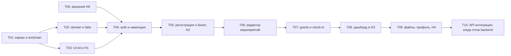

# План разработки для агентов

**Изменение 27 октября:** применять [ответы B01–B08](12-backend-answers-2026-10-27.md) с последним уточнением B02: гостю сразу показываем QR и сохраняем компактные данные в saved state текущего flow до его закрытия; аккаунт автоматически не создаём. Анкета перед входом не сохраняется; телефон optional; reset по коду, confirm → ручной вход.

Статус на 29 октября: **T01 — READY_FOR_HUMAN**, **T02 — IN_PROGRESS (T02.1–T02.3 по нужным фичам)**, **T03 — DONE (H1)**, **T04 — DONE (auth smoke подтверждён пользователем)**, **T05 — READY_FOR_HUMAN (H2 ожидается)**, T06–T09 — TODO. Исторические статусы ниже сохраняют даты. Подагенты не разрешены этим планом.

## Порядок



После каркаса T02 и T03 технически независимы. Это возможность разделения работы при явном разрешении пользователя, а не необходимость. Сначала один сквозной сценарий, затем расширение; не писать все экраны по отдельности на несвязанных фикстурах.

## T00 — подтвердить продуктовые развилки

**Вход:** `01-product.md`, Q01–Q14 в `08-decisions.md`. **Владелец:** человек вместе с агентом, позднее backend-команда.

**Выход:** кратко отметить принятое решение и дату; не переписывать исходный Figma snapshot. Приоритет H0: телефон, возврат после входа, завершение события/история, пересечение связей внутри одного E. Удаление аккаунта согласовать до реализации разрушительного сценария; остальные независимые задачи можно выполнять.

**Проверка:** у каждой развилки есть решение или явное временное допущение с точкой, до которой оно допустимо. Молчание пользователя не считается утверждением.

**Обновление 2026-10-21:** пользователь принял рабочие варианты, отдельно подтвердил выдачу гостевого билета сразу (Q04) и фиксацию вопросов после первого участника (Q08). Q06 и Q11 не блокируют demo: используем явный статус события и отдельный ручной код; будущие правила обсуждаются с backend. Для каркаса/UI-kit повторное одобрение H0 не требуется. См. [старт без API](11-start-without-api.md) и [backend brief](10-backend-brief.md).

## T01 — воспроизводимый Android-каркас

**Зависимости:** нет для технического каркаса. **Файлы:** root build, wrapper, version catalog, пять модулей из архитектуры; последующие общие изменения build согласуются одним ответственным агентом.

**Вход:** `02-architecture.md`, `09-android-stack.md`.

Дополнительный ориентир — [правила реализации](14-engineering-rules.md), раздел «Первый практический шаг T01». До массового кода доказать Route/Screen/ViewModel/DI на одном минимальном demo-репозитории. Это проверка архитектуры, не все продуктовые фичи.

**Статус 27 октября: READY_FOR_HUMAN.** Созданы wrapper, каталог версий и пять минимальных модулей. Используется Quail 2026.1.2 (`Android Studio1`), её JBR 21.0.10, Gradle 9.5.0/AGP 9.3.3/Kotlin 2.4.21; minSdk 28, compile/target 37. Старое обследование в 11 — история, не выбранная среда сборки.

**Фактический выход:** `app/build/outputs/apk/demo/debug/app-demo-debug.apk`, `0.1.0-t01-demo`, seed `t01-v1`; три таба, один demo-route, Hilt MVVM/repository и saved state. Assemble, lint (0 errors / 6 version notices), 7 unit tests, 3 device tests на API 36.1, проверка demo isolation и настоящий background process death пройдены. Полные команды, SHA-256, ограничения и ручные шаги — [15-t01-validation.md](15-t01-validation.md). Подагенты не запускались; ревью-скилл не применялся. Ручной smoke, API 28/физическое устройство и H1–H4 не отмечены пройденными. Следующий этап — первая предметная часть T02 и T03.

**Сделать:** проверить локальные Android SDK/JDK/Studio; выбрать совместимый стабильный toolchain; Kotlin DSL, minSdk 28, Compose/Hilt/KSP, одна Activity; `demoDebug` variant; запрет production fake; стартовая оболочка; маленький navigation spike: три таба, вложенный маршрут, Hilt ViewModel, восстановление после recreation/process death и deep link.

**Выход:** собираемый APK, зафиксированные версии и реальные команды в README, назначенные applicationId/namespace. `:data:remote` пока не создавать. Не устанавливать случайный JDK, не заменять wrapper системным Gradle.

**Авто:** assemble demoDebug, Android lint, минимальная проверка DI/создания ViewModel и сериализации route. **Человек:** запуск на целевом устройстве и Back/tab smoke. Проблемы совместимости устранять до массового UI-кода; Navigation 2 — только документированный fallback ADR-03.

## T02 — домен, права, контракты и общий fake

**Зависимости:** T01; принятые Q-решения либо локально обозначенные временные defaults. **Владение:** `core/domain`, `data/fake`; публичные типы координирует один агент.

**Вход:** `02-architecture.md`, `05-data-contracts.md`.

**Сделать:** ID types, модели, access policy, repository ports, fake store, fixtures S01–S14, Clock/ID injection, счётчики. Гостевая запись без userId; submit возвращает GuestTicketSnapshot. После отдельного signUp/confirm/signIn доступны билеты на email. Persistence данных fake-сервера, Reset и outbox; без pending forms и постоянного клиентского guest cache. Серверную конкуренцию мест не моделировать.

**Выход:** связный локальный backend-заменитель и debug controls, контрактные тесты без UI.

Порты/фикстуры из 05 — целевой перечень, а не требование реализовать их все до первого экрана. T02 выполнять итерациями вместе с фичами: сначала публичное E + guest submit + временный QR, затем auth/билеты по email, затем организатор/check-in. Полный набор S01–S14 доводится к соответствующим T-задачам; не строить отдельный универсальный серверный движок.

**Авто:** изоляция E-A/E-B/E-C/E-D, grant revoke независимо от ticket, обработка CapacityReached/Closed, повтор check-in, отмена, билеты по email после отдельного создания аккаунта, права и session isolation. **Человек:** отдельная проверка UI не нужна.

**T02.2, 28 октября:** независимая auth-итерация для T04 подготовлена: AuthRepository/типизированные результаты, общий fake, auth snapshot и demo outbox API; session coordinator/модель guards и возврата. 54 unit и 7 device API 33, assemble/lint/isolation прошли. Весь T02 остаётся IN_PROGRESS: полная persistence guest registrations/tickets и остальные команды нужны к T05/H2. См. [18-t04-validation.md](18-t04-validation.md).

## T03 — UI-kit и общая оболочка

**Зависимости:** T01. **Владение:** `core/designsystem`, previews, навигационные визуальные компоненты без бизнес-логики.

**Статус 27 октября: READY_FOR_HUMAN.** Токены/Inter, базовые компоненты/состояния, векторные glyph и общие панели реализованы; галерея из «Билеты → Открыть UI-кит», также поверх demo-счётчика. Текущий APK `0.3.1-t03-demo`, code 3: исправлен P2 ревью `a263c21` — перекрытие профиля боковой системной панелью. Для исправления прошли assemble/lint (0 errors / 6 version notices), 6 app unit, demo isolation и все 6 device-тестов API 33 с тремя кнопками; регрессия поворотов отдельно прошла с жестами. Исходная T03 прошла 25 unit и 5 device на API 36.1. Figma прочитана частично до нового Starter limit; точная визуальная H1/TalkBack/вся матрица размеров ещё ожидаются. Источники, команды, APK SHA-256, red/green и checklist — [17-t03-validation.md](17-t03-validation.md). Версии стека и T02-контракты не менялись; следующий этап после H1 — T04 и соответствующая часть T02.

**Дополнение после ревью 4e3d0de:** исправление P2 подтверждено пользователем; доработана синхронизация device-теста после поворота и системное нажатие. С жестами прошли 4 адресных прогона подряд; полный набор 6 device-тестов API 33 прошёл отдельно с жестами и с тремя кнопками. Повторно исполнены 6 app unit, assemble/lint/isolation прошли. APK 0.3.1 не менялся, H1 ожидается; подробности и неуспешные промежуточные попытки — в отчёте T03.

**Вход:** `04-design-system.md`, блок 06 Figma. Восстановить визуальную проверку панелей при доступности Figma; при лимите дать человеку прямые ссылки.

**Сделать:** токены, Inter, кнопки, поля, checkbox/switch, tabs, badges, карточки, состояния/диалоги; экран галереи debug с примерами. Ресурсы и иконки с проверенными источниками.

**Авто:** сборка/lint; не писать тест на каждое значение цвета. **Человек H1:** галерея, 360–412dp, keyboard/insets, font scaling и эталон Figma. Результат: один согласованный набор компонентов перед построением всех экранов.

## T04 — auth, app shell и pending navigation

**Приёмка 29 октября: DONE.** Пользователь ответил «Проверил, замечаний нет» на вопрос по ручному auth smoke APK 0.4.3-t04-demo / code 7. Устройство/Android не указаны. Зависимая интеграция T05 разрешена; H2 этим не закрыта. Ниже — история T04 до приёмки.

**Статус 29 октября: READY_FOR_HUMAN.** После подтверждённой H1 реализованы auth Route/ViewModel/Screen, outbox UI, Login startup, Activity links и session gate с очисткой root/hidden owners, foreground/expiry и guards. APK `0.4.3-t04-demo`, code 7; 56 JVM и 13 device API 33, assemble/Hilt/lint (0 errors / 4 warnings)/isolation прошли. Ручной auth smoke ожидается, H2 не закрыта. Следующая задача — T05. [18-t04-validation.md](18-t04-validation.md). Ниже сохранён foundation-этап 28 октября.

**Зависимости:** T02, T03, Q03. **Владение:** `feature/auth`, app navigation, session coordinator.

**Статус 28 октября: IN_PROGRESS.** Исправлены P2 ревью cfc0624: поздняя отмена входа и retry подтверждения. P2 ревью 055c14b также исправлен: единый coroutine Mutex приостанавливает ожидание общего fake-состояния без блокировки caller; всего 8 auth-регрессий. По условию prompt выполнены независимая T02.2 и модель auth-навигации; H1 не подтверждена. APK `0.4.2-t04-foundation-demo`, code 6 сохраняет техническую T03-оболочку/галерею. 54 unit исполнены повторно, 7 device на Pixel 7/API 33 (три кнопки), Hilt/assemble/lint (0 errors / 4 version warnings)/isolation прошли. Остаток после H1: G03–G05/confirm/reset Route–ViewModel–Screen, demo outbox UI, Login startup и подключение session gate к текущим stacks/decorators, foreground/expiry refresh, новые Activity links и auth device smoke. Полной готовности T04 нет; [18-t04-validation.md](18-t04-validation.md).

**Сделать:** G03/G04/G05, VerifyEmail → ручной Login, ResetPassword email → код → новый пароль, общий shell и guards. Возврат на E хранит только маршрут, не ответы. Без PendingActionStore для анкеты и автозавершения регистрации. Удалять приватный стек после logout/expiry, закрыть кабинет до подтверждения аккаунта.

**Авто:** login failure/success/verification без автоматической сессии, reset по коду, return route без сохранения/отправки формы, Forbidden/Unauthenticated. **Человек:** краткий прогон входа/назад; полная приёмка с T05.

## T05 — первый сквозной сценарий: мероприятие → регистрация → билет

**Статус 29 октября: READY_FOR_HUMAN.** После принятого auth smoke T04 реализованы общий E/форма, guest receipt + QR/saved-state/fullscreen, Tickets/история/отмена и T02.3 server persistence v2 с миграцией auth v1. APK 0.5.0-t05-demo, code 8; 71 JVM/18 device API 33, QR decoder, реальная смерть процесса/та же task/новая task, assemble/lint/isolation прошли. H2 ожидается; следующая задача — T06. [19-t05-validation.md](19-t05-validation.md). Ниже сохранена исходная постановка, включая статусы до выполнения.

**Зависимости:** T04. **Владение:** `feature/event`, `feature/tickets`.

**Сделать:** общий G01/P01, optional российский телефон и имя на любом языке, renderer вопросов; состояния capacity/closed/started/not found/already registered. G02 показывает QR + сообщение о письме без автосоздания User. GuestTicketSnapshot в SavedStateHandle/onSaveInstanceState текущего flow: возврат/пересоздание восстанавливают QR, явное закрытие очищает. Не создавать постоянный guest cache. P02 после входа: все билеты на email, fullscreen QR, history/empty, отмена Active. Анкету перед входом не сохранять. Письма имитировать; PDF для вошедшего до T09 незавершён.

**Авто:** формы/consent, optional phone, Unicode-имя; гостевой QR восстанавливается в той же записи flow, но не после её удаления; нет сохранения/автоотправки анкеты; билеты после отдельного signUp и входа. **Человек H2:** G02, соседний экран/Back, пересоздание Activity, закрытие flow и новый запуск без guest ticket; новая/существующая почта и пересечения связей. Потеря ответов анкеты при входе ожидаема по B04.

## T06 — создание и управление своими мероприятиями

**Зависимости:** T05; Q06/Q08/Q12. **Владение:** `feature/my-events`, `feature/editor`.

Q08/Q12 приняты. По B05 владелец может закрыть регистрацию/завершить событие; endsAt завершает автоматически, startsAt закрывает новые заявки. Вопросы анкеты блокировать после первой регистрации, а не после первого check-in.

**Сделать:** общий O01/V01 c тремя вкладками, draft list; O02 create/edit, редактор вопроса text/checkbox/single-choice, обложка, валидация, сохранение и публикация O03. Копирование ссылки/Android share. Убрать платное и шаги. Консистентные formVersion и существующие ответы; даты демонстрации через Clock.

**Авто:** draft неполный сохраняется, publish неполный запрещён, лимит меньше количества участников запрещён по принятому правилу, formVersion, редактирование чужого E запрещено. **Человек:** создать событие, добавить/удалить вопросы, открыть сгенерированную ссылку гостем; черновик переживает перезапуск.

## T07 — права волонтёра и сканер

**Зависимости:** T06. **Владение:** `feature/volunteers`, `feature/checkin`, camera adapter.

**Сделать:** O05 grant/revoke, общий V02, ручной ввод и CameraX/QR decoder, один запрос на распознанный код до ответа, три состояния результата V03–V05, back/next без накопления стека, permission denied и сетевые сбои. Права перепроверяются при операции; revoke во время открытой камеры.

**Авто:** ветки check-in, один клиентский запрос до ответа, повтор Used, camera throttling, Forbidden без PII, Timeout не равен invalid/успеху. Идемпотентность requestId проверять только после подтверждения API на T10. **Человек:** реальный QR с другого экрана/бумаги, фокус/слабый свет, отказ камеры, ручной ввод. Эмуляция decoder не доказывает работу камеры.

## T08 — дашборд и соединение сценариев

**Зависимости:** T07. **Владение:** `feature/dashboard`, интеграция observe-потоков.

**Сделать:** O04, live counters, список/поиск, отмена участника, переходы Volunteers/Scanner, freshness/error. Подписки должны обновляться от того же store, что TicketRepository. Не включать аналитику MAX.

**Авто:** check-in обновляет ticket/dashboard/grant count; revoke удаляет доступ только к E; cancel освобождает место; фильтр не меняет общие счётчики; пагинация/поиск согласованы; нет прав на чужой список.

**Человек H3:** один аккаунт с четырьмя видами связей; владелец сканирует сам; выдача/отзыв и смена debug-личности; после прохода видеть Used и рост явки. Fake на одном устройстве не заменяет будущую проверку двух устройств.

## T09 — завершение MVP и ручная приёмка

**Зависимости:** T08; Q09/Q10/Q11 и согласованный экспорт. **Владение:** `feature/profile`, file adapters, интеграционные исправления.

**Сделать:** полный профиль, email preference, сохранение и возврат; PDF/XLSX настоящими файлами (fixtures/локальная генерация в demo, API port для будущего backend), повторы писем; удаление по согласованному контракту; пустые/ошибочные состояния всех фич, process death, insets, доступность, достаточная производительность списков.

**Авто:** regressions бизнес-инвариантов, file metadata/stream, очистка сессии, исключение fake из production. **Человек H4:** чек-лист `07-validation.md` на API 28 и актуальной Android-версии; установка APK, камера, файлы, links и long text. Обозначить build id, seed и оставшиеся дефекты.

**Выход:** принятый demo MVP, пригодный для API-интеграции. Его нельзя объявлять production-ready без backend.

## T10 — интеграция API (внешняя зависимость)

**Зависимости:** доступный backend и согласованные контракты; T09 не обязательно ждать для ранней сверки схемы.

**Сделать:** remote adapters, auth storage, DTO mapping, App Links на принадлежащем команде домене, файлы/письма сервера, реальное обновление дашборда; заменить DI. Совместимые UI/ViewModel не переписывать без основания. Сохранить fake для demo и тестов.

**Авто:** общие repository contract tests + transport tests + staging authorization/concurrency tests. **Человек:** H2–H4 на API, два устройства/два сканера, потеря сети после submit, реальные письма и их ссылки. Не автоматизировать рассылку на реальные адреса без отдельного разрешения.

## Handoff между агентами

### Как распределяем работу

Порядок ниже — схема выполнения после начала реализации. Обсуждение плана не запускает подагентов; отдельное разрешение на параллельную работу сохраняется по AGENTS.md.

| Ответственный | Зона работы | Ограничения |
|---|---|---|
| Основной агент — координатор/интегратор | Сценарии, общие контракты, Gradle/версии/DI/navigation, интеграция, итоговая сборка, отчёт человеку | Один владелец общих файлов; не менять принятые продуктовые правила без основания |
| Агент данных | Конкретная итерация domain/fake: модели, операции, фикстуры и предметные unit tests | Получает согласованные сигнатуры; не редактирует UI/navigation/build по собственной инициативе |
| Агент интерфейса | UI-kit или ограниченный feature-пакет: Screen/UiState/ViewModel, previews, ресурсы | Использует текущие порты и компоненты; не делает отдельный fake в каждом экране |
| Проверяющий агент (отдельная короткая задача) | Читать diff, искать нарушения границ/сценариев, оценивать проверки | Подключается к готовому изменению; замечания возвращает интегратору, не меняет одновременно чужие файлы |
| Человек | H1/H2/H3/H4 на конкретном APK и seed | Решает визуальные/UX-вопросы; агент не отмечает приёмку за человека |

На старте T01 выполняется одним агентом. После подтверждения общих контрактов полезно разделить данные и UI: обычно достаточно двух исполнителей и координатора. Постоянную команду из большого числа агентов на каждую задачу не создаём. Проверяющий подключается по размеру/риску изменения, а не автоматически к каждому небольшому файлу.

### Рабочие итерации и результат для человека

| Итерация | Задачи и распределение | Результат / точка проверки |
|---|---|---|
| 1. Фундамент | Координатор: T01, Git/local build hygiene, wrapper, MVVM/DI, три таба и один вложенный маршрут | Собираемый demoDebug, зафиксированные версии/команды; проверены state ownership и навигационный smoke |
| 2. Общая основа | После T01: агент UI — T03; агент данных — только event/registration/guest snapshot часть T02 | Галерея компонентов и минимальные общие данные. H1: человек сверяет UI-kit |
| 3. Первый полный пользовательский путь | Координатор соединяет T04/T05; данные расширяются под auth/tickets, UI строит event/guest QR/auth/tickets по стабильным портам | Ссылка → форма → временный QR; возврат/recreation/закрытие. Отдельно signUp → подтверждение → ручной login → билеты на email. H2 |
| 4. Организатор | T06; интерфейс редактора/списков и данные событий можно разделить после согласования операций | Черновик, публикация, анкета, ссылка, закрытие регистрации/завершение события |
| 5. Волонтёр и контроль входа | T07/T08: shared scanner, grants, dashboard; интегратор связывает общий store и обновления | Выдача/отзыв, три результата scan, явка; H3 с пересечением связей пользователя |
| 6. Завершение demo | T09: профиль, файлы, ошибки/пустые состояния, реальные ограничения Android | APK + воспроизводимый чек-лист. H4 на API 28/актуальной версии и физической камере |
| 7. Настоящий сервер | T10 после API-контракта | Remote adapters, staging, повтор H2–H4; UI-контракты меняются только при реальном изменении сценария |

Полная T02 не является блокирующей отдельной фазой: её части делаются для текущей итерации. Гейт H1 требует результата UI-kit, H2 — связного пользовательского сценария, а не только готовых отдельных экранов.

### Что получает исполнитель

Карточка задачи содержит: цель и границы; актуальные документы/узлы Figma; разрешённые пути изменения; входные типы и сигнатуры; требуемые состояния/фикстуры; конкретные критерии приёмки; минимальные проверки; формат передачи результата. Подзадача достаточно мала, чтобы после неё можно было собрать и проверить наблюдаемое поведение.

При изменении публичного интерфейса исполнитель сначала сообщает интегратору, какие вызывающие места затронуты; затем изменение применяется последовательно. Два агента не переписывают одновременно version catalog, навигационный реестр или один repository interface. Для независимых изменений границы файлов/checkout определяются до начала; параллельные сборки в одном рабочем каталоге не запускаются. Независимый review и итоговая сборка выполняются после интеграции.

### Что ещё уточнять до старта

Новых обязательных продуктовых ответов для T01 нет. EventPass и технический applicationId можно использовать как временные demo-значения; final package/domain/signing нужны до публикации, не до каркаса. Версии, namespace и репозиторий — обратимые решения T01 с записью результата.

Способ ручной приёмки по умолчанию: агент предоставляет APK, seed и короткий чек-лист; человек проверяет на своём Android или доступном эмуляторе. Модель конкретного устройства полезна перед H1/H4, но не блокирует код. Не запрашивать повторно одобрение Android 9+, MVVM, отдельных связей, гостевого saved state и optional phone.

Неизвестные session refresh/manual code/timezone/files/deletion API уточняются перед соответствующей интеграцией. Отсутствие этих ответов не блокирует каркас и связанные стабы; используемый временный вариант обязательно обозначается в задаче.

Каждая законченная задача оставляет короткий отчёт:

```text
Task: Txx; status: TODO / IN_PROGRESS / READY_FOR_HUMAN / DONE / BLOCKED
Build/commit identifier:
Changed paths and public contracts:
Assumptions / Q decisions used:
Exact commands run + results:
Manual checks: pending / accepted by <person, date, build>
Remaining defects and next task:
```

`DONE` требует технических проверок и относящейся к этапу человеческой приёмки. Агент может завершить кодовую часть как READY_FOR_HUMAN и продолжить независимую работу. Общее правило: один владелец меняет build/version catalog, один — domain contracts/navigation registry; не позволять нескольким будущим агентам незаметно менять одни и те же интерфейсы.

## Текущий журнал

| Элемент | Состояние | Свидетельство |
|---|---|---|
| Android Code Review T01 | Существующий отчёт прочитан перед T02; блокирующих находок нет | `CODE_REVIEW.md` относится к be20799; полное повторное ревью T02 не запускалось |
| Исследование и документация | Подготовлены | Текущий набор docs, исходный Figma snapshot |
| H0 | Продуктовые ответы получены; детали API отложены | Q-реестр, включая дополнительные ответы Q04/Q08 |
| T01 | READY_FOR_HUMAN, 27 октября 2026 | APK 0.1.0-t01-demo; assemble/lint/7 unit/3 device/isolation/process death прошли; `15-t01-validation.md`. Ручной smoke ожидается |
| T02 | IN_PROGRESS; T02.1–T02.3 подготовлены | Общий fake/server snapshot v2, auth migration, guest/auth submit и свой cancel; 71 JVM/18 device/OS restore. Editor/check-in и другие команды ещё впереди; `19-t05-validation.md` |
| T03 | DONE; H1 подтверждена 29 октября | Принятый UI-кит используется в T04, повторная H1 не запрашивается; текущий срез — `18-t04-validation.md`, история — `17-t03-validation.md` |
| T04 | DONE, 29 октября | Auth smoke code 7 подтверждён пользователем «Проверил, замечаний нет»; устройство не указано. `18-t04-validation.md` |
| T05 | READY_FOR_HUMAN | APK 0.5.0-t05-demo/code 8, guest QR/registration/Tickets/cancel/server persistence; H2 ожидается; `19-t05-validation.md` |
| T06–T09 | TODO | Следующий этап после H2 — T06 |
| H1 | Подтверждена пользователем 29 октября | Условие UI-интеграции T04 выполнено; `18-t04-validation.md` |
| H2–H4 | Ожидаются | Ручной auth smoke T04 не закрывает H2, следующая задача — T05 |
| T10 | Будущий этап | API отсутствует по запросу пользователя |
