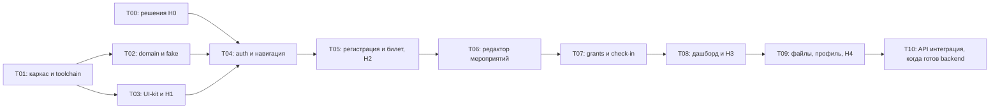

# План разработки для агентов

**M09 — PARTIAL_EXTERNAL / HUMAN_PENDING, code26.** Android интеграция и технические проверки завершены в разрешённом объёме; фактические результаты, APK и оставшиеся внешние условия — [единая матрица](validation/t10-m09-final-validation.md). Ручная приёмка финального remote build не закрыта.

## История промежуточных срезов

**17 ноября — M08 IMPLEMENTED/COMPILE_VERIFIED; поведение NOT_VERIFIED.** Remote profile PATCH/delete и server XLSX подключены к общим UI/ports; product ticket resend удалён. [Архитектура M08](architecture/t10-profile-delete-documents.md), [compile/NOT_RUN](validation/t10-m08-implementation.md). Одна remote Kotlin/Java/DI компиляция прошла; suites/lint/demo/staging/APK/device/review не запускались. Старые review/H-пункты не закрыты. M09 TODO, ручная приёмка после M09.

**T09a — READY_FOR_HUMAN (7 ноября):** адресное обновление видимой поверхности жестом реализовано на code 20. 187 JVM / 26 device + 9 повторов с жестами, assemble/lint/DI/isolation прошли; [результаты и новый checklist](30-t09a-refresh-validation.md). Новый UX ждёт человека; предыдущая приёмка 6 ноября сохраняется, Q10/T10 отдельно.

**Документационная задача — DONE:** по запросу пользователя актуализирована архитектура T01–T06 по `c569152`, без изменения приложения. Текущие 00/02/03/05 и карты `docs/architecture/` отделяют реализацию от T07+; прежние спецификации сохранены в истории. Результат и правила поддержки — [maintenance](architecture/maintenance.md). Структурная проверка ссылок/реестров/указателей на тесты и diff пройдена; Mermaid runtime rendering и Android tests в этой задаче не выполнялись. Эта задача не закрывает организаторский smoke T06 и не запускает T07.

**Изменение 27 октября:** применять [ответы B01–B08](12-backend-answers-2026-10-27.md) с последним уточнением B02: гостю сразу показываем QR и сохраняем компактные данные в saved state текущего flow до его закрытия; аккаунт автоматически не создаём. Анкета перед входом не сохраняется; телефон optional; reset по коду, confirm → ручной вход.

Актуальный статус на 6 ноября: **T01 и T03–T08 — DONE; H1–H4 приняты пользователем для реализованного demo; независимый срез T09 принят.** T02 продолжается по оставшимся фичам; полная T09 — IN_PROGRESS из-за Q10/deletion, T10 ожидает backend/API. Основание — прямое «если что все ручные проверки я закрыл и принял»; [запись приёмки](validation/2026-11-06-manual-acceptance.md). Build/устройство каждого пункта не уточнены; code 19 — последний подготовленный APK, а не приписанный всем проверкам build.

## Порядок



После каркаса T02 и T03 технически независимы. Это возможность разделения работы при явном разрешении пользователя, а не необходимость. Сначала один сквозной сценарий, затем расширение; не писать все экраны по отдельности на несвязанных фикстурах.

## T00 — подтвердить продуктовые развилки

**Вход:** `01-product.md`, Q01–Q14 в `08-decisions.md`. **Владелец:** человек вместе с агентом, позднее backend-команда.

**Выход:** кратко отметить принятое решение и дату; не переписывать исходный Figma snapshot. Приоритет H0: телефон, возврат после входа, завершение события/история, пересечение связей внутри одного E. Удаление аккаунта согласовать до реализации разрушительного сценария; остальные независимые задачи можно выполнять.

**Проверка:** у каждой развилки есть решение или явное временное допущение с точкой, до которой оно допустимо. Молчание пользователя не считается утверждением.

**Обновление 2026-10-21:** пользователь принял рабочие варианты, отдельно подтвердил выдачу гостевого билета сразу (Q04) и фиксацию вопросов после первого участника (Q08). Q06 и Q11 не блокируют demo: используем явный статус события и отдельный ручной код; будущие правила обсуждаются с backend. Для каркаса/UI-kit повторное одобрение H0 не требуется. См. [старт без API](11-start-without-api.md) и [backend brief](10-backend-brief.md).

## T01 — воспроизводимый Android-каркас

**Зависимости:** нет для технического каркаса. **Файлы:** root build, wrapper, version catalog, пять модулей из архитектуры; последующие общие изменения build согласуются одним ответственным агентом.

**Вход:** `02-architecture.md`, `09-android-stack.md`.

Дополнительный ориентир — [правила реализации](14-engineering-rules.md), раздел «Первый практический шаг T01». До массового кода доказать Route/Screen/ViewModel/DI на одном минимальном demo-репозитории. Это проверка архитектуры, не все продуктовые фичи.

**Статус 27 октября: READY_FOR_HUMAN.** Созданы wrapper, каталог версий и пять минимальных модулей. Используется Quail 2026.1.2 (`Android Studio1`), её JBR 21.0.10, Gradle 9.5.0/AGP 9.3.3/Kotlin 2.4.21; minSdk 28, compile/target 37. Старое обследование в 11 — история, не выбранная среда сборки.

**Фактический выход:** `app/build/outputs/apk/demo/debug/app-demo-debug.apk`, `0.1.0-t01-demo`, seed `t01-v1`; три таба, один demo-route, Hilt MVVM/repository и saved state. Assemble, lint (0 errors / 6 version notices), 7 unit tests, 3 device tests на API 36.1, проверка demo isolation и настоящий background process death пройдены. Полные команды, SHA-256, ограничения и ручные шаги — [15-t01-validation.md](15-t01-validation.md). Подагенты не запускались; ревью-скилл не применялся. Ручной smoke, API 28/физическое устройство и H1–H4 не отмечены пройденными. Следующий этап — первая предметная часть T02 и T03.

**Сделать:** проверить локальные Android SDK/JDK/Studio; выбрать совместимый стабильный toolchain; Kotlin DSL, minSdk 28, Compose/Hilt/KSP, одна Activity; `demoDebug` variant; запрет production fake; стартовая оболочка; маленький navigation spike: три таба, вложенный маршрут, Hilt ViewModel, восстановление после recreation/process death и deep link.

**Выход:** собираемый APK, зафиксированные версии и реальные команды в README, назначенные applicationId/namespace. `:data:remote` пока не создавать. Не устанавливать случайный JDK, не заменять wrapper системным Gradle.

**Авто:** assemble demoDebug, Android lint, минимальная проверка DI/создания ViewModel и сериализации route. **Человек:** запуск на целевом устройстве и Back/tab smoke. Проблемы совместимости устранять до массового UI-кода; Navigation 2 — только документированный fallback ADR-03.

## T02 — домен, права, контракты и общий fake

**Зависимости:** T01; принятые Q-решения либо локально обозначенные временные defaults. **Владение:** `core/domain`, `data/fake`; публичные типы координирует один агент.

**Вход:** `02-architecture.md`, `05-data-contracts.md`.

**Сделать:** ID types, модели, access policy, repository ports, fake store, fixtures S01–S14, Clock/ID injection, счётчики. Гостевая запись без userId; submit возвращает GuestTicketSnapshot. После отдельного signUp/confirm/signIn доступны билеты на email. Persistence данных fake-сервера, Reset и outbox; без pending forms и постоянного клиентского guest cache. Серверную конкуренцию мест не моделировать.

**Выход:** связный локальный backend-заменитель и debug controls, контрактные тесты без UI.

Порты/фикстуры из 05 — целевой перечень, а не требование реализовать их все до первого экрана. T02 выполнять итерациями вместе с фичами: сначала публичное E + guest submit + временный QR, затем auth/билеты по email, затем организатор/check-in. Полный набор S01–S14 доводится к соответствующим T-задачам; не строить отдельный универсальный серверный движок.

**Авто:** изоляция E-A/E-B/E-C/E-D, grant revoke независимо от ticket, обработка CapacityReached/Closed, повтор check-in, отмена, билеты по email после отдельного создания аккаунта, права и session isolation. **Человек:** отдельная проверка UI не нужна.

**T02.2, 28 октября:** независимая auth-итерация для T04 подготовлена: AuthRepository/типизированные результаты, общий fake, auth snapshot и demo outbox API; session coordinator/модель guards и возврата. 54 unit и 7 device API 33, assemble/lint/isolation прошли. Весь T02 остаётся IN_PROGRESS: полная persistence guest registrations/tickets и остальные команды нужны к T05/H2. См. [18-t04-validation.md](18-t04-validation.md).

## T03 — UI-kit и общая оболочка

Готовый запрос для нового агента: [prompts/t03-ui-kit.md](prompts/t03-ui-kit.md). Он учитывает завершённую T02.1 и существующие отчёты ревью; это задание на реализацию, не свидетельство выполнения T03.

**Зависимости:** T01. **Владение:** `core/designsystem`, previews, навигационные визуальные компоненты без бизнес-логики.

**Статус 27 октября: READY_FOR_HUMAN.** Токены/Inter, базовые компоненты/состояния, векторные glyph и общие панели реализованы; галерея из «Билеты → Открыть UI-кит», также поверх demo-счётчика. Текущий APK `0.3.1-t03-demo`, code 3: исправлен P2 ревью `a263c21` — перекрытие профиля боковой системной панелью. Для исправления прошли assemble/lint (0 errors / 6 version notices), 6 app unit, demo isolation и все 6 device-тестов API 33 с тремя кнопками; регрессия поворотов отдельно прошла с жестами. Исходная T03 прошла 25 unit и 5 device на API 36.1. Figma прочитана частично до нового Starter limit; точная визуальная H1/TalkBack/вся матрица размеров ещё ожидаются. Источники, команды, APK SHA-256, red/green и checklist — [17-t03-validation.md](17-t03-validation.md). Версии стека и T02-контракты не менялись; следующий этап после H1 — T04 и соответствующая часть T02.

**Дополнение после ревью 4e3d0de:** исправление P2 подтверждено пользователем; доработана синхронизация device-теста после поворота и системное нажатие. С жестами прошли 4 адресных прогона подряд; полный набор 6 device-тестов API 33 прошёл отдельно с жестами и с тремя кнопками. Повторно исполнены 6 app unit, assemble/lint/isolation прошли. APK 0.3.1 не менялся, H1 ожидается; подробности и неуспешные промежуточные попытки — в отчёте T03.

**Вход:** `04-design-system.md`, блок 06 Figma. Восстановить визуальную проверку панелей при доступности Figma; при лимите дать человеку прямые ссылки.

**Сделать:** токены, Inter, кнопки, поля, checkbox/switch, tabs, badges, карточки, состояния/диалоги; экран галереи debug с примерами. Ресурсы и иконки с проверенными источниками.

**Авто:** сборка/lint; не писать тест на каждое значение цвета. **Человек H1:** галерея, 360–412dp, keyboard/insets, font scaling и эталон Figma. Результат: один согласованный набор компонентов перед построением всех экранов.

## T04 — auth, app shell и pending navigation

**Приёмка 29 октября: DONE.** Пользователь ответил «Проверил, замечаний нет» на вопрос по ручному auth smoke APK 0.4.3-t04-demo / code 7. Устройство/Android не указаны. Зависимая интеграция T05 разрешена; H2 этим не закрыта. Ниже — история T04 до приёмки.

**Статус 29 октября: READY_FOR_HUMAN.** После подтверждённой H1 реализованы auth Route/ViewModel/Screen, outbox UI, Login startup, Activity links и session gate с очисткой root/hidden owners, foreground/expiry и guards. APK `0.4.3-t04-demo`, code 7; 56 JVM и 13 device API 33, assemble/Hilt/lint (0 errors / 4 warnings)/isolation прошли. Ручной auth smoke ожидается, H2 не закрыта. Следующая задача — T05. [18-t04-validation.md](18-t04-validation.md). Ниже сохранён foundation-этап 28 октября.

Следующая итерация: [промпт оставшейся UI-интеграции T04](prompts/t04-ui-integration.md), подготовлен после ревью `893486e` от 28 октября без новых подтверждённых дефектов в проверенном diff. Независимая foundation-часть уже выполнена. **29 октября пользователь подтвердил H1: UI-интеграцию можно начинать без повторного подтверждения.** [Исходный полный prompt](prompts/t04-auth-navigation.md) сохранён для истории. T04 остаётся IN_PROGRESS до реализации и проверок.

**Зависимости:** T02, T03, Q03. **Владение:** `feature/auth`, app navigation, session coordinator.

**Статус 28 октября: IN_PROGRESS.** Исправлены P2 ревью cfc0624: поздняя отмена входа и retry подтверждения. P2 ревью 055c14b также исправлен: единый coroutine Mutex приостанавливает ожидание общего fake-состояния без блокировки caller; всего 8 auth-регрессий. По условию prompt выполнены независимая T02.2 и модель auth-навигации; H1 не подтверждена. APK `0.4.2-t04-foundation-demo`, code 6 сохраняет техническую T03-оболочку/галерею. 54 unit исполнены повторно, 7 device на Pixel 7/API 33 (три кнопки), Hilt/assemble/lint (0 errors / 4 version warnings)/isolation прошли. Остаток после H1: G03–G05/confirm/reset Route–ViewModel–Screen, demo outbox UI, Login startup и подключение session gate к текущим stacks/decorators, foreground/expiry refresh, новые Activity links и auth device smoke. Полной готовности T04 нет; [18-t04-validation.md](18-t04-validation.md).

**Сделать:** G03/G04/G05, VerifyEmail → ручной Login, ResetPassword email → код → новый пароль, общий shell и guards. Возврат на E хранит только маршрут, не ответы. Без PendingActionStore для анкеты и автозавершения регистрации. Удалять приватный стек после logout/expiry, закрыть кабинет до подтверждения аккаунта.

**Авто:** login failure/success/verification без автоматической сессии, reset по коду, return route без сохранения/отправки формы, Forbidden/Unauthenticated. **Человек:** краткий прогон входа/назад; полная приёмка с T05.

## T05 — первый сквозной сценарий: мероприятие → регистрация → билет

**Актуальный статус T05: DONE.** Back/H2 повторно приняты пользователем на code 13 1 ноября, ответ «Проверил оба, замечаний нет». [Свидетельство](23-navigation-back-validation.md). Устройство/Android не сообщены; H3/H4 ожидаются.

**Статус 29 октября: READY_FOR_HUMAN.** P2 ревью `1e54b80` исправлен: finally отменённой заявки не снимает busy новой; RED/GREEN для guest/authenticated. Текущий APK `0.5.1-t05-demo`, code 9; 73 JVM, assemble app/test APK, lint/isolation успешны. Ранее пройденные 18 device + 6 повторов/real process proof относятся к code 8, новых runtime-прогонов нет. Общий E/форма, guest QR/saved state, Tickets/cancel и server snapshot v2 реализованы; H2 ожидается, после неё — T06. [19-t05-validation.md](19-t05-validation.md). Ниже — исходная постановка, включая статусы до выполнения.

Готовый запрос: [prompts/t05-registration-tickets.md](prompts/t05-registration-tickets.md), подготовлен после ревью `646a1e2` без новых подтверждённых P0–P3 в проверенном diff. H1 подтверждена; ручной auth smoke T04 ещё ожидается. До его результата разрешена независимая domain/fake/persistence часть T05, зависимая интеграция — после приёмки auth. Подготовка промпта не закрывает T04/H2 и не означает начала реализации T05.

**Зависимости:** T04. **Владение:** `feature/event`, `feature/tickets`.

**Сделать:** общий G01/P01, optional российский телефон и имя на любом языке, renderer вопросов; состояния capacity/closed/started/not found/already registered. G02 показывает QR + сообщение о письме без автосоздания User. GuestTicketSnapshot в SavedStateHandle/onSaveInstanceState текущего flow: возврат/пересоздание восстанавливают QR, явное закрытие очищает. Не создавать постоянный guest cache. P02 после входа: все билеты на email, fullscreen QR, history/empty, отмена Active. Анкету перед входом не сохранять. Письма имитировать; PDF для вошедшего до T09 незавершён.

**Авто:** формы/consent, optional phone, Unicode-имя; гостевой QR восстанавливается в той же записи flow, но не после её удаления; нет сохранения/автоотправки анкеты; билеты после отдельного signUp и входа. **Человек H2:** G02, соседний экран/Back, пересоздание Activity, закрытие flow и новый запуск без guest ticket; новая/существующая почта и пересечения связей. Потеря ответов анкеты при входе ожидаема по B04.

## T06 — создание и управление своими мероприятиями

**Актуальный статус T06: DONE.** Back/H2 и T06 приняты пользователем на code 13; устройство/Android не сообщены. H3/H4 ожидаются.

**Текущий статус — DONE, 1 ноября.** Организаторский smoke принят на code 13 тем же явным ответом пользователя; [свидетельство](20-t06-validation.md). Условие продолжения UI T07 снято. Ниже — история реализации и прежних ожиданий.

**30 октября — READY_FOR_HUMAN.** H2 принята по актуальной записи пользователя; MyEvents/editor/вопросы/cover/publish/link/close/finish подключены к общему store. 101 JVM и 9 device прошли, app/test APK/lint/isolation успешны. Code 11, `0.6.1-t06-demo`; ручной организаторский smoke остаётся за человеком, H3 целиком не закрыта. [Отчёт и checklist](20-t06-validation.md). Далее сохранена история foundation 29 октября.

**Условие начала UI выполнено: H2 принята пользователем.** Независимая foundation-часть уже реализована в `797b24e`; следующий шаг — MyEvents/editor UI, picker/обложка, copy/share и сквозная интеграция. Не повторять domain/fake/persistence заново и не спрашивать H2 повторно. Актуальный [промпт T06](prompts/t06-event-editor.md), [остаток](20-t06-validation.md). T06 остаётся IN_PROGRESS; запись ниже описывает этап до H2.

**29 октября — IN_PROGRESS.** Пользователь ответил «Ещё не проверял — выполнить независимую часть T06». H2/T05 остаются ожидающими. Выполнены контракты списка/редактора, отдельные неполные черновики, owner/session/revision guards, save/publish/update/close/finish в общем store, schema 3 с миграциями v1/v2 и тестами. 94 JVM, app/test APK, lint/isolation успешны; APK 0.6.0-t06-foundation-demo/code 10. MyEvents/editor UI, route guards, picker/durable cover adapter, clipboard/share и сквозной UI-путь не подключены. [Доказательства и точный остаток](20-t06-validation.md).

Готовый запрос: [prompts/t06-event-editor.md](prompts/t06-event-editor.md), после ревью `dbbbea1` без новых подтверждённых P0–P3 в проверенном исправлении. Кодовая основа T05 готова; H2 ожидается на `0.5.1-t05-demo`, code 9. До приёмки можно выполнять независимую domain/fake/persistence часть T06, полную UI-интеграцию — после H2. Промпт не закрывает приёмки; начало независимой части зафиксировано выше.

**Зависимости:** T05; Q06/Q08/Q12. **Владение:** `feature/my-events`, `feature/editor`.

Q08/Q12 приняты. По B05 владелец может закрыть регистрацию/завершить событие; endsAt завершает автоматически, startsAt закрывает новые заявки. Вопросы анкеты блокировать после первой регистрации, а не после первого check-in.

**Сделать:** общий O01/V01 c тремя вкладками, draft list; O02 create/edit, редактор вопроса text/checkbox/single-choice, обложка, валидация, сохранение и публикация O03. Копирование ссылки/Android share. Убрать платное и шаги. Консистентные formVersion и существующие ответы; даты демонстрации через Clock.

**Авто:** draft неполный сохраняется, publish неполный запрещён, лимит меньше количества участников запрещён по принятому правилу, formVersion, редактирование чужого E запрещено. **Человек:** создать событие, добавить/удалить вопросы, открыть сгенерированную ссылку гостем; черновик переживает перезапуск.

## T07 — права волонтёра и сканер

**T07 — DONE, принято 6 ноября.** Пользователь закрыл все подготовленные ручные проверки, включая camera/UI; [запись приёмки](validation/2026-11-06-manual-acceptance.md). Code 15/revoke dialog/optional camera и автоматические результаты — [история реализации](25-t07-fixes-validation.md).

Готовый запрос для продолжения: [prompts/t07-ui-integration.md](prompts/t07-ui-integration.md). Старый [полный промпт](prompts/t07-volunteers-checkin.md) сохраняется как история до foundation. Q11/B11 API пока предложение, demo ManualCode уже реализован. Backend не блокирует UI T07; H3 целиком — после T08.

**Зависимости:** T06. **Владение:** `feature/volunteers`, `feature/checkin`, camera adapter.

**Сделать:** O05 grant/revoke, общий V02, ручной ввод и CameraX/QR decoder, один запрос на распознанный код до ответа, три состояния результата V03–V05, back/next без накопления стека, permission denied и сетевые сбои. Права перепроверяются при операции; revoke во время открытой камеры.

**Авто:** ветки check-in, один клиентский запрос до ответа, повтор Used, camera throttling, Forbidden без PII, Timeout не равен invalid/успеху. Идемпотентность requestId проверять только после подтверждения API на T10. **Человек:** реальный QR с другого экрана/бумаги, фокус/слабый свет, отказ камеры, ручной ввод. Эмуляция decoder не доказывает работу камеры.

## T08 — дашборд и соединение сценариев

**T08 — DONE, принято 6 ноября, H3 закрыта.** Пользователь закрыл ручные проверки текущего demo; [запись приёмки](validation/2026-11-06-manual-acceptance.md). Dashboard/shared attendance/search/pages/cancel и refresh fix готовы; технические результаты своих сборок — [26](26-t08-validation.md)/[27](27-t08-refresh-validation.md).

**Промпт подготовлен 2 ноября:** [prompts/t08-dashboard-attendance.md](prompts/t08-dashboard-attendance.md), после чтения ревью `6de02da` без новых подтверждённых P0–P3; обе прежние P2 исправлены. Историческая постановка была TODO; технический результат реализации приведён выше. Кодовая T07 готова, её camera/UI-приёмка code 15 остаётся ожидающей. Независимые dashboard/domain/fake/UI/отмена/поиск можно выполнять на готовых портах, не меняя неподтверждённое поведение камеры; общий H3 принимается человеком после T07+T08. Реальный backend пока не требуется, API-предложение не считается согласованным.

**Зависимости:** T07. **Владение:** `feature/dashboard`, интеграция observe-потоков.

**Сделать:** O04, live counters, список/поиск, отмена участника, переходы Volunteers/Scanner, freshness/error. Подписки должны обновляться от того же store, что TicketRepository. Не включать аналитику MAX.

**Авто:** check-in обновляет ticket/dashboard/grant count; revoke удаляет доступ только к E; cancel освобождает место; фильтр не меняет общие счётчики; пагинация/поиск согласованы; нет прав на чужой список.

**Человек H3:** один аккаунт с четырьмя видами связей; владелец сканирует сам; выдача/отзыв и смена debug-личности; после прохода видеть Used и рост явки. Fake на одном устройстве не заменяет будущую проверку двух устройств.

## T09 — завершение MVP и ручная приёмка

**6 ноября — независимый срез принят, H4 для текущего demo закрыта.** [запись приёмки](validation/2026-11-06-manual-acceptance.md). Профиль/PDF/XLSX/resend/SAF приняты; полная T09 остаётся IN_PROGRESS из-за несогласованного Q10/deletion. Отсутствующая функция не становится реализованной через приёмку доступного UI. Новые согласования/проверки T10 потребуются после появления backend. Постановки ниже сохраняют контекст до приёмки.

**IN_PROGRESS, независимый срез READY_FOR_HUMAN, 2 ноября.** Профиль, schema 5/v1–v4 migration, настоящие demo PDF/XLSX/SAF и resend готовы. Code 19 исправляет configuration lifetime SAF: 66 app JVM/5 device, [29](29-t09-saf-recreation-validation.md). Исходные 176 JVM/code 18 и единый checklist — [28](28-t09-validation.md). Полный T09 не DONE: Q10/deletion и ручные T07/H3/H4 остаются. API/T10 не начаты.

**Промпт независимой части подготовлен 2 ноября:** [prompts/t09-profile-files.md](prompts/t09-profile-files.md). Прочитано ревью `aaca508`: новых подтверждённых P0–P3 нет, прежняя P2 позднего refresh исправлена. Можно выполнять профиль, настоящие demo PDF/XLSX, повтор писем через fake outbox и подготовку H4 на готовой кодовой T08. T07 camera/UI и T08/H3 ещё ждут человека; постановка не закрывает приёмки и не запускает реализацию. Q10/каскад удаления и окончательные серверные file/email правила не согласованы: удаление отложено до решения, файлы/письма — явно обратимые demo defaults. При постановке T09 было TODO; текущий IN_PROGRESS указан выше, полное завершение требует закрыть остаток, а не только независимый срез. Backend требуется для T10.

**Зависимости:** T08; Q09/Q10/Q11 и согласованный экспорт. **Владение:** `feature/profile`, file adapters, интеграционные исправления.

**Сделать:** полный профиль, email preference, сохранение и возврат; PDF/XLSX настоящими файлами (fixtures/локальная генерация в demo, API port для будущего backend), повторы писем; удаление по согласованному контракту; пустые/ошибочные состояния всех фич, process death, insets, доступность, достаточная производительность списков.

**Авто:** regressions бизнес-инвариантов, file metadata/stream, очистка сессии, исключение fake из production. **Человек H4:** чек-лист `07-validation.md` на API 28 и актуальной Android-версии; установка APK, камера, файлы, links и long text. Обозначить build id, seed и оставшиеся дефекты.

**Выход:** принятый demo MVP, пригодный для API-интеграции. Его нельзя объявлять production-ready без backend.

## T09a — обновление экрана жестом сверху вниз

**READY_FOR_HUMAN, code 20, 7 ноября.** Реализован разрешённый объём: общий EventPassRefresh, шесть Screen / семь поверхностей, scoped read-порты Profile/Volunteers, visible + RESUMED и owner/observation guards. 187 JVM / 26 device API 33 + 9 повторов с жестами, assemble/lint/DI/isolation прошли; [APK/hash/checklist](30-t09a-refresh-validation.md), [текущее поведение](architecture/t09a-refresh.md). Новая человеческая приёмка ожидается; DONE не отмечен.

**Зависимости:** принятый реализованный demo T09 и текущие VM/repository ports; Q10/удаление и backend не нужны. **Владение:** общий gesture/indicator в `core:designsystem`, адресное wiring и state/refresh guards продуктовых Route/ViewModel.

**Сделать:** убрать все обычные продуктовые кнопки/ссылки «Обновить»; pull-to-refresh у Tickets/current/history/card, MyEvents/current segment, Event текущего eventId, Dashboard/Volunteers текущего E и безопасного чтения Profile. Gesture owner — только текущая видимая entry, с учётом nested scroll; hidden tab/parent не получает callback. Пустое/короткое/error content поддерживает жест. Оставить typed error retry и отдельные mutation retries. Editor/auth/Scanner/guest receipt/fullscreen/modals/SAF не приобретают общий reload: формы/QR/команды/разрешения не теряются и не повторяются. Сохранить сегмент, выбор, query и dirty input; observer/refresh/generation guards и один выполняющийся refresh.

**Авто:** callback/repository/resource E1 vs E2, отсутствие команд скрытого экрана, настоящий swipeDown сверху и отсутствие refresh в середине списка, empty/error/повтор/завершение indicator, поздние ответы после stop/logout, сохранность форм/guest receipt/Back/SAF. Публикация общего store связанным observers допустима и не считается ошибочным refresh соседнего экрана. Доступность — semantic action без обычной видимой кнопки.

**Человек:** отдельный smoke нового жеста на новой сборке: root tab, внутренние сегменты, вложенные E/Dashboard/Volunteers и Back; short/empty/error; modal/fullscreen; профиль с правками, query и состояние индикатора; доступное действие обновления. Прежняя общая приёмка 6 ноября не закрывает T09a автоматически. **Выход:** READY_FOR_HUMAN после технических проверок, DONE после подтверждения. Новый отчёт T09a, APK/hash и проверки; T09/Q10 и T10 ведутся отдельно.

## T10 — интеграция API (внешняя зависимость)

**14 ноября:** M00 TECH_ACCEPTED; M01 REVIEW_PENDING — реальные signup/login→profile, secure token/recovery и изоляция вариантов. [Отчёт M01](validation/t10-m01-implementation.md), [архитектура](architecture/t10-session-transport.md). M02–M09 TODO; следующая реализация только после независимого ревью M01.

**Историческая постановка, 13 ноября: IN_PROGRESS, самостоятельная реализация M00–M09 разрешена пользователем. M00 REVIEW_PENDING; M01–M09 TODO.** Полный сравнительный анализ, архитектурные ADR-T10-01–07, последовательные M00–M09, зависимости и критерии — [34-api-migration-plan.md](34-api-migration-plan.md). Повторное разрешение на каждый этап не требуется. [Журнал и формат отчётов](35-t10-execution.md), [mapping M00](api/migration-mapping.md). После каждого цельного этапа — автоматические проверки, актуализация текущей документации и отдельное android-code-review, затем исправления/повторное ревью при необходимости. Ручная приёмка только после всего цикла, включая T09a; исторические H-гейты ниже не требуют промежуточного запроса человеку. TECH_ACCEPTED этапа не означает HUMAN_ACCEPTED приложения. Эта постановка заменяет прежний общий порядок T10 ниже в части последовательности/гейтов.

**13 ноября — можно начинать первый remote-срез.** [Проверка обновления](33-backend-update-2026-11-13.md): backend `def6565`, staging API 1.1.1 доступен, BK01–BK09 реализованы; 55 сценарных проверок и 3 cleanup прошли. Внешняя зависимость по наличию ручек снята для начала интеграции, T10 начат с документационного M00; remote-код ещё не написан. App Links отложены пользователем. Null URL документов согласия и доступ к staging-почте остаются условиями полной приёмки auth/consent; реальные device/network/SMTP проверки не закрыты этим API-прогоном. Пустой guest phone маппить в `""`.

**Последнее уточнение пользователя:** default окончания startsAt+4 часа, явный endsAt заменяет default, manual finish остаётся. Новую ticket resend-функцию не реализуем; первоначальные письма/auth resend остаются. Backend-файл [32](32-backend-final-requirements.md) сокращён до необходимых доработок. Отдельный Android-план — remote draft + Room cache/pending offline без ложного server success, решение в 08. При адаптации убрать старый demo ticket resend UI/порт в затронутом срезе; прежняя реализация и её приёмка остаются историей.

**Итоговое согласование пользователя, 13 ноября:** [32 — необходимые доработки backend](32-backend-final-requirements.md) заменяет прежнее OpenAPI-предложение по перечисленным вопросам. Принимаем server /api, autoaccount, immediate session/unverified login, reset-link, один bearer 30 дней, slug/DTO/direct PDF/EVT; backend добавляет BK/IN расширения. Q10/каскад DELETE без пароля согласован, остаётся Android-реализация и проверка. Не отмечать T09/T10 DONE по одному решению. Исторические ожидания согласования ниже не требуют повторного запроса принятых вариантов.

**13 ноября — backend исследован, интеграция ещё не начата.** Пользователь предоставил `EgorDikanskiy/eventpass`; [сравнение снимка `94af06f`](31-backend-gap-analysis-2026-11-13.md) содержит таблицу всех 44 target операций, предметные конфликты и порядок согласования. Существование исходников не означает готовый согласованный staging. Сначала auth/guest/lifecycle/анкета, затем вертикальные remote adapters; Q10 и серверная приёмка остаются отдельными. Текущая Android-реализация не менялась.

**Подготовка контракта, 31 октября — DONE как документационная задача:** по запросу пользователя проанализированы текущий код/порты, решения и полный объём мобильного MVP; подготовлены [API v0.1.0](22-backend-api-contract.md), OpenAPI, примеры и mapping. Статус самого T10 остаётся будущим: сервера/remote нет, backend ещё не согласовал предложения. Проверки комплекта — [coverage](api/coverage.md). Следующее действие — передать комплект backend и зафиксировать согласование §15, затем первый вертикальный срез auth → событие → регистрация → билет. Приёмки H и работа T07 этим не меняются.

**Зависимости:** доступный backend и согласованные контракты; T09 не обязательно ждать для ранней сверки схемы.

**Сделать:** remote adapters, auth storage, DTO mapping, файлы/письма сервера, реальное обновление дашборда; заменить DI. App Links отложены решением пользователя 13 ноября, не входят в текущий обязательный срез T10. Совместимые UI/ViewModel не переписывать без основания. Сохранить fake для demo и тестов.

**Авто:** общие repository contract tests + transport tests + staging authorization/concurrency tests. **Человек:** H2–H4 на API, два устройства/два сканера, потеря сети после submit, реальные письма и их ссылки. Не автоматизировать рассылку на реальные адреса без отдельного разрешения.

## Handoff между агентами

### Как распределяем работу

Порядок ниже — схема выполнения после начала реализации. Обсуждение плана не запускает подагентов; отдельное разрешение на параллельную работу сохраняется по AGENTS.md.

| Ответственный | Зона работы | Ограничения |
|---|---|---|
| Основной агент — координатор/интегратор | Сценарии, общие контракты, Gradle/версии/DI/navigation, интеграция, итоговая сборка, отчёт человеку | Один владелец общих файлов; не менять принятые продуктовые правила без основания |
| Агент данных | Конкретная итерация domain/fake: модели, операции, фикстуры и предметные unit tests | Получает согласованные сигнатуры; не редактирует UI/navigation/build по собственной инициативе |
| Агент интерфейса | UI-kit или ограниченный feature-пакет: Screen/UiState/ViewModel, previews, ресурсы | Использует текущие порты и компоненты; не делает отдельный fake в каждом экране |
| Проверяющий агент (отдельная короткая задача) | Читать diff, искать нарушения границ/сценариев, оценивать проверки | Подключается к готовому изменению; замечания возвращает интегратору, не меняет одновременно чужие файлы |
| Человек | H1/H2/H3/H4 на конкретном APK и seed | Решает визуальные/UX-вопросы; агент не отмечает приёмку за человека |

На старте T01 выполняется одним агентом. После подтверждения общих контрактов полезно разделить данные и UI: обычно достаточно двух исполнителей и координатора. Постоянную команду из большого числа агентов на каждую задачу не создаём. Проверяющий подключается по размеру/риску изменения, а не автоматически к каждому небольшому файлу.

### Рабочие итерации и результат для человека

| Итерация | Задачи и распределение | Результат / точка проверки |
|---|---|---|
| 1. Фундамент | Координатор: T01, Git/local build hygiene, wrapper, MVVM/DI, три таба и один вложенный маршрут | Собираемый demoDebug, зафиксированные версии/команды; проверены state ownership и навигационный smoke |
| 2. Общая основа | После T01: агент UI — T03; агент данных — только event/registration/guest snapshot часть T02 | Галерея компонентов и минимальные общие данные. H1: человек сверяет UI-kit |
| 3. Первый полный пользовательский путь | Координатор соединяет T04/T05; данные расширяются под auth/tickets, UI строит event/guest QR/auth/tickets по стабильным портам | Ссылка → форма → временный QR; возврат/recreation/закрытие. Отдельно signUp → подтверждение → ручной login → билеты на email. H2 |
| 4. Организатор | T06; интерфейс редактора/списков и данные событий можно разделить после согласования операций | Черновик, публикация, анкета, ссылка, закрытие регистрации/завершение события |
| 5. Волонтёр и контроль входа | T07/T08: shared scanner, grants, dashboard; интегратор связывает общий store и обновления | Выдача/отзыв, три результата scan, явка; H3 с пересечением связей пользователя |
| 6. Завершение demo | T09: профиль, файлы, ошибки/пустые состояния, реальные ограничения Android | APK + воспроизводимый чек-лист. H4 на API 28/актуальной версии и физической камере |
| 7. Настоящий сервер | T10 после API-контракта | Remote adapters, staging, повтор H2–H4; UI-контракты меняются только при реальном изменении сценария |

Полная T02 не является блокирующей отдельной фазой: её части делаются для текущей итерации. Гейт H1 требует результата UI-kit, H2 — связного пользовательского сценария, а не только готовых отдельных экранов.

### Что получает исполнитель

Карточка задачи содержит: цель и границы; актуальные документы/узлы Figma; разрешённые пути изменения; входные типы и сигнатуры; требуемые состояния/фикстуры; конкретные критерии приёмки; минимальные проверки; формат передачи результата. Подзадача достаточно мала, чтобы после неё можно было собрать и проверить наблюдаемое поведение.

При изменении публичного интерфейса исполнитель сначала сообщает интегратору, какие вызывающие места затронуты; затем изменение применяется последовательно. Два агента не переписывают одновременно version catalog, навигационный реестр или один repository interface. Для независимых изменений границы файлов/checkout определяются до начала; параллельные сборки в одном рабочем каталоге не запускаются. Независимый review и итоговая сборка выполняются после интеграции.

### Что ещё уточнять до старта

Новых обязательных продуктовых ответов для T01 нет. EventPass и технический applicationId можно использовать как временные demo-значения; final package/domain/signing нужны до публикации, не до каркаса. Версии, namespace и репозиторий — обратимые решения T01 с записью результата.

Способ ручной приёмки по умолчанию: агент предоставляет APK, seed и короткий чек-лист; человек проверяет на своём Android или доступном эмуляторе. Модель конкретного устройства полезна перед H1/H4, но не блокирует код. Не запрашивать повторно одобрение Android 9+, MVVM, отдельных связей, гостевого saved state и optional phone.

Неизвестные session refresh/manual code/timezone/files/deletion API уточняются перед соответствующей интеграцией. Отсутствие этих ответов не блокирует каркас и связанные стабы; используемый временный вариант обязательно обозначается в задаче.

Каждая законченная задача оставляет короткий отчёт:

```text
Task: Txx; status: TODO / IN_PROGRESS / READY_FOR_HUMAN / DONE / BLOCKED
Build/commit identifier:
Changed paths and public contracts:
Assumptions / Q decisions used:
Exact commands run + results:
Manual checks: pending / accepted by <person, date, build>
Remaining defects and next task:
```

`DONE` требует технических проверок и относящейся к этапу человеческой приёмки. Агент может завершить кодовую часть как READY_FOR_HUMAN и продолжить независимую работу. Общее правило: один владелец меняет build/version catalog, один — domain contracts/navigation registry; не позволять нескольким будущим агентам незаметно менять одни и те же интерфейсы.

## Текущий журнал

| Элемент | Состояние | Свидетельство |
|---|---|---|
| Android Code Review T01 | Существующий отчёт прочитан перед T02; блокирующих находок нет | `CODE_REVIEW.md` относится к be20799; полное повторное ревью T02 не запускалось |
| Исследование и документация | Подготовлены | Текущий набор docs, исходный Figma snapshot |
| H0 | Продуктовые ответы получены; детали API отложены | Q-реестр, включая дополнительные ответы Q04/Q08 |
| T01 | DONE, принято 6 ноября | Общая ручная приёмка каркаса текущего demo; `validation/2026-11-06-manual-acceptance.md`. Первоначальные технические результаты — `15-t01-validation.md` |
| T02 | IN_PROGRESS; срезы по фичам | Общий store/schema 5, Profile/Documents и T09 UI; 176 JVM в текущем срезе; remote порты впереди. |
| T03 | DONE, 29 октября 2026 | UI-кит/Inter/галерея/оболочка; технические проверки и история исправлений — `17-t03-validation.md`. H1 прямо подтверждена пользователем; устройство и build id приёмки не указаны |
| T04 | DONE, 29 октября | Auth smoke code 7 подтверждён пользователем «Проверил, замечаний нет»; устройство не указано. `18-t04-validation.md` |
| T05 | DONE | Back/H2 приняты пользователем на code 13. |
| T06 | DONE | Организаторский smoke принят пользователем на code 13. |
| T07 | DONE, принято 6 ноября | Camera/UI закрыты пользователем; `validation/2026-11-06-manual-acceptance.md` |
| T08 | DONE, принято 6 ноября | Dashboard/явка и H3 приняты; `validation/2026-11-06-manual-acceptance.md` |
| T09 | IN_PROGRESS; независимый срез принят | Приёмка 6 ноября сохраняется. Q10 согласован 13 ноября как server DELETE без пароля; остаётся реализация/проверка, auth/guest/API-адаптация по 32 |
| T09a | READY_FOR_HUMAN, code 20 | Обычные refresh buttons удалены; адресный pull/semantic action, single-flight и retention, 187 JVM / 26 device; `30-t09a-refresh-validation.md`. Новый UX ждёт человека |
| H1 | Пройдена человеком, 29 октября 2026 | Прямое подтверждение пользователя; `17-t03-validation.md`. Условие начала UI-интеграции T04 снято |
| H2 | Принята пользователем | Back/H2 ранее приняты на code 13; все подготовленные ручные проверки demo подтверждены 6 ноября |
| H3–H4 | Приняты пользователем 6 ноября | Для реализованного demo, без приписывания конкретных устройств/API и будущих функций; `validation/2026-11-06-manual-acceptance.md` |
| T10 | Ожидается backend | Пользователь отправил требования, ответ ожидается. Контракт пока предложение; demo-разработку можно продолжать |
