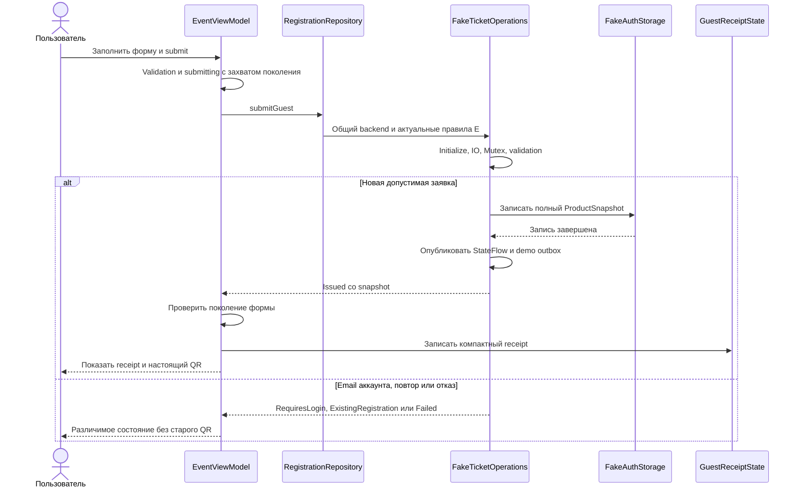
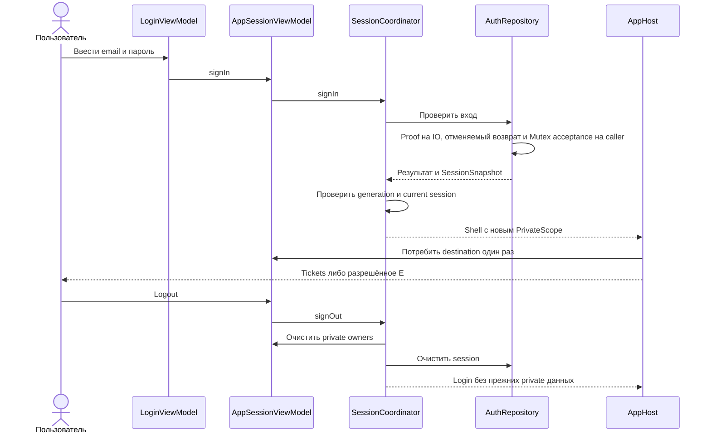
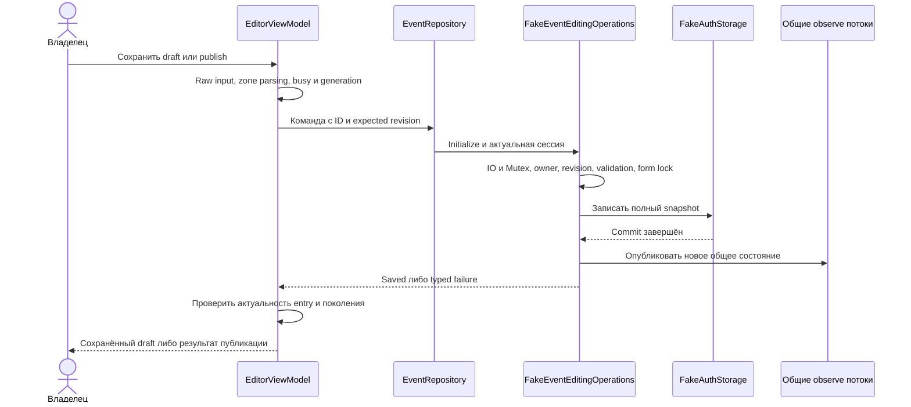

# Сквозные операции и точки фиксации

M01 auth/session: [актуальная карта](t10-session-transport.md); продуктовые editor/check-in/files вне M01 пока demo.

UI T01–T06 сверено по `c569152`; добавлены независимые T07 server operations. Это последовательности текущего приложения/fake, а не HTTP-контракт. Полные сигнатуры — в [портах](../../core/domain/src/main/kotlin/ru/eventpass/core/domain/ProductRepositories.kt), хранение — [05](../05-data-contracts.md). Последовательности не заменяют проверки отмены и сессии в исходниках.

## Гостевая заявка

Новый guest submit не создаёт Account. `RequiresLogin` очищает ответы, сохраняет только email/назначение E через auth host. Успешный Login не вызывает submit автоматически. ExistingRegistration гостю не даёт ticketId/повторный payload. Аккаунт позже читает билеты по своей подтверждённой сессии/email из repository.

Значимый порядок: **disk commit → общий StateFlow → результат → проверка поколения UI → SavedStateHandle → receipt UI**. При уходе формы `leaveForm` увеличивает поколение до отмены job. И результат, и finally старой операции должны уважать это поколение. Отсутствие видимого успеха при отмене после commit не означает, что записи на fake-сервере нет; автоматического retry мутации нет.

## Вход, подтверждение и выход

M01 signup принимает session сразу; unverified signIn разрешён; verify сохраняет существующую session, reset по mail link подтверждает email и требует последующего login. Confirmation link идёт MainActivity → retained delivery → AuthLinkHandler → completeEmailLink → сообщение; remote mail links выполняются browser. При failure/cancellation inFlight снимается, явный retry возможен; handled предотвращает повтор **успешной доставки с тем же requestId**, не является server idempotency protocol.

Auth acceptance отдельно защищена: подготовленная transient session не публикуется до отменяемого возврата на caller. Ожидание занятого общего Mutex приостанавливает корутину, не блокирует поток caller. После публикации session до возврата нет дополнительного suspend/dispatcher hop. Durable account/challenge изменения, напротив, уже могут быть записаны при отмене caller.

## Сохранение и публикация мероприятия

Неполный draft допустим; `publishDraft` требует валидных полей. `EventDraft.publishedEventId` — сохранённый receipt публикации: повтор publish одного draft не создаёт второй E. Публикация не равна Clipboard/Share: эти platform actions используют уже созданную ссылку, отмена Sharesheet не откатывает E.

Editor держит raw строки даты/лимита отдельно от domain EventFields. Парсинг использует выбранную zone; неоднозначные/несуществующие DST local times отклоняются. Dirty/busy input не заменяется новым наблюдаемым document автоматически; stale revision даёт Conflict с сохранением ввода.

После первой успешной Registration вопросы/варианты фиксируются по **истории registrations**, а не числу текущих Active tickets. Cancel всех не разрешает правку. Metadata update не меняет formVersion без изменения схемы. Server TicketSnapshot получает актуальные title/date/venue/zone при update E без смены QR/status; ранее выданный guest receipt остаётся снимком выдачи.

## Platform-ветка обложки

OpenDocument → временный content URI → CoverImporter → AndroidEventCoverStore: ограниченное чтение, проверка MIME/dimensions/decode → managed file → EventCover descriptor → явное сохранение draft/E. Preview/EXIF отдельно через EventCoverPreview и entry VM. Bitmap/bytes не попадают в route или snapshot.

GC запускается перед первым import процесса через demo binding; retained IDs берутся из всех сохранённых E/drafts общего store. При unhealthy snapshot очистка пропускается. Новый несохранённый asset может жить в текущем процессе до последующей очистки; после process death несохранённая форма не обещает его восстановление. Managed file copy и snapshot — разные записи, не единая файловая транзакция.

## Как расширять операцию

- Отметить границу actor/access и expected revision/formVersion до мутации.
- Определить persisted часть, точку commit и публикуемый Flow; все writers общего snapshot обязаны сохранить данные соседних фич.
- Обозначить состояние pending/result/error и жизнь результата при Back/logout/recreation.
- Для отмены отдельно проверить queued, до commit, после commit и поздний UI finally. Не обещать rollback только на основании cancel job.
- Добавить сценарий в [реестр инвариантов](invariants.md), сослаться на test и актуальный отчёт.

## Независимые grants/check-in T07

Owner list/grant/revoke и checkIn используют initialize → captured session generation → общий IO/Mutex → текущие verification/expiry/EventAccessPolicy → полный schema 4 write → общий StateFlow → typed outcome. Grant/revoke не меняют registrations/tickets/history. Active check-in меняет тот же ticket на Used и добавляет первый record; повтор возвращает его без записи второго. Ошибка записи не публикует успех. ScannerController повторно сверяет access/generation после suspend и не показывает PII позднего ответа новой сессии. [Подробная операция и proof pointers](t07-checkin-foundation.md).

Scanner Route/entry VM → прежний ScannerController → CheckInRepository. CameraX Y plane → stride/crop copy → ZXing QR candidates → main dispatcher/generation gate. Result/submitting удаляет preview, каждый ImageProxy закрывается в finally. Volunteers Route/VM → прежний VolunteerRepository; hidden/background отменяет observation/command и очищает transient input/confirmation. [Точное wiring](t07-ui-lifecycle.md). AttendanceRepository подключён на том же state; [операции T08](t08-attendance.md).

## Owner attendance T08

Observe/page/refresh: initialize → current authenticated owner guard → один immutable state → totals/header + bounded rows без credentials. Sorted consentAcceptedAt DESC/ID, token event/revision/query/offset. VM принимает refresh reply только при прежнем owner/observation generation; более новый observer результат имеет приоритет, pending page reread объединяется в один follow-up, stop очищает очередь. Relevant revision меняет список: VM сбрасывает к первой странице; поиск не влияет на totals. Volunteer.checkedInCount — реальные first records, а не попытки/legacy Used.

Owner cancel: captured generation → IO/общий Mutex → current owner/event/registration/ticket/status → общий TicketCancellation с self path → полный schema 4 write → StateFlow. Used запрещён, Cancelled idempotent; registration history/questions lock/checkIns сохраняются. Failure не публикует ложный результат. Modal error и retry привязаны к той же registration; hidden/late finally защищены owner token. [Точный контракт](t08-attendance.md).

## Profile/save, document transfer и resend T09

Save: current generation → authenticated actor guard под общим Mutex/IO → полный schema 6 disk commit → StateFlow, без изменения Account/Session; имя только AuthData.names. Новые формы получают name/phone, история не меняется. Export: CreateDocument → проверка прежней сессии → prepare одного snapshot → private temp → повторный доступ до/после open и chunks → flush/close → validate → UI success. Cancel/close failure не успех; частичный внешний файл отозвать не обещаем. Resend добавляет FakeTicketEmail в прежний outbox, cooldown/retryAt от auth Clock, явный retry без новых tickets. [Подробная операция](t09-profile-files.md).

Configuration dispose SAF не завершает entry operation: Route передаёт Activity.isChangingConfigurations, VM сохраняет pending/launched/session/writer; bind того же resource не сбрасывает. Обычный dispose/hidden/resource/session change очищает. [Регрессия и результаты](../29-t09-saf-recreation-validation.md).

## Адресный pull-to-refresh T09a

Жест сверху/semantic action → callback видимого Screen → entry VM single-flight/captured owner/resource → read ровно своего repository → guarded observer/result → прежний контент + refreshing/read error. Profile/Volunteers имеют scoped read-порты без записи/мутаций. Dashboard stale page допускает один внутренний follow-up, пользовательские дубли игнорируются. Dirty profile обновляет baseline/сообщает конфликт без замены fields, изменение questions public E сохраняет совместимые answers по stable IDs/type/options, несовместимые объясняет StaleForm. Stop/hidden/смена ресурса/сессии инвалидируют поздний result/finally. [T09a](t09a-refresh.md).

## M02: public resource и типизированная анкета

Реализованы отдельные EventSlug/PublicEventReference, RemoteEventRepository public GET, scoped session/owner read guards, совместимые typed answers и bounded UTF-8 schema6/legacy reset policy. Фактические владельцы/последовательности/migration bounds/test pointers — [M02 public E](t10-public-event.md); статус и запущенные проверки — [implementation](../validation/t10-m02-implementation.md). Guest/idempotency/manual-code/tickets/PDF мигрированы в M03; online editor/MyEvents/covers подключены в M04; Room/offline drafts подключены в M05; scanner/volunteers подключены в M06; attendance подключён в M07; profile mutations/XLSX/resend cleanup относятся к M08–M09.

## M03: регистрации, билеты и PDF

Submit: новая команда → локальная validation → сохранение immutable command/marker → repository; неопределённый исход → явный replay прежнего body/key без validation по новой анкете. Adapter сохраняет actor/expiry/cooldown guards. Read ticket: own GET/refresh → отдельная selectedCard; scoped list GET → только data списка. Результаты применяются к текущему owner/selection, не объединяются по ticketId в server items. Back очищает карточку, сохраняя исходный server list/counters.

[Текущие модели, owners, операции, guards, storage и test pointers](t10-registration-tickets.md), [evidence/ограничения](../validation/t10-m03-implementation.md). RemoteRegistrations/RemoteTickets/RemoteTicketDocuments отвечают за protocol/actor/transport; EventViewModel — immutable pending command/receipt; TicketsViewModel — scope/card/visible refresh; DocumentsViewModel + AndroidDocumentFiles — transient SAF и отмена. После ревью 3277e90 исправлены две P2; [проверки исправлений](../validation/t10-m03-p2-fixes.md), повторное ревью cec5520 принято пользователем 17 ноября: [свидетельство](../validation/t10-m03-user-review-confirmation.md).

## M04–M05: owner editor, Room и обложки

RemoteEventRepository оставляет public reads и делегирует draft-операции LocalDraftRepository; RemoteOrganizerRepository обслуживает server MyEvents и online published edit/finish. data:local — Android Room library без HTTP/DTO; domain DraftStore задаёт узкую границу. App/remote DI открывает private noBackup DB и связывает auth purge, managed files и coordinator. В demo Room не подключён.

EventDraft.local ID, remoteEventId и slug различаются. DraftStore хранит account partition, incarnation/storage CAS, confirmed/base/pending, localRevision, неизменную create-команду и pending cover reference. LocalDraftState отличается от серверного успеха; localDrafts не входят в server items/counters. EditorKey.remoteDraftId адресует серверный draft, safe saved metadata сохраняет разрешённый local ID; fields/command восстанавливаются из Room после валидного входа того же account.

Save пишет только на устройство; sync — отдельная foreground команда. Room-транзакции короткие, HTTP/file IO вне них. ACK A сохраняет pending B; logout/deletion fence запрещает позднему ответу создать запись заново. После неизвестного PATCH — GET, затем ack или явный конфликт base/local/remote. Merge сохраняет stable IDs; выбор пользователя сначала локален. Publish/finish online. Pending cover копируется в private durable file, upload descriptor фиксируется до attach; release только после перехода DB/проверки ссылок. GET→PATCH не атомарен без server precondition.

[Таблица состояний, доступ, retention и точки commit](t10-room-drafts.md). [Проверки и NOT_RUN](../validation/t10-m05-implementation.md). M03 registration replay/server list scope не переписаны; их повторные регрессии в M05 не запускались по команде пользователя.

## M06: remote scanner/volunteers

GET scanner → server access/info; POST scan с прежним code/key при unknown; replayed нейтрален, local increment отсутствует. GET/POST/DELETE volunteers адресованы одному E, DELETE204 не декодируется. Visible resume/manual read не выполняют POST, hidden polling нет. [Детальная текущая модель](t10-scanner-volunteers.md), [выполненная проверка/NOT_RUN](../validation/t10-m06-implementation.md).

## M07: dashboard/участники

Stats + первая страница одной revision принимаются вместе. STALE_PAGE сбрасывает цепочку и bounded reload; ticketId cancel требует server подтверждения, затем visible E/query read и адресная ticket/scanner invalidation без polling hidden tab. [Текущая модель](t10-dashboard-attendees.md), [реальная проверка и ограничения](../validation/t10-m07-implementation.md).
