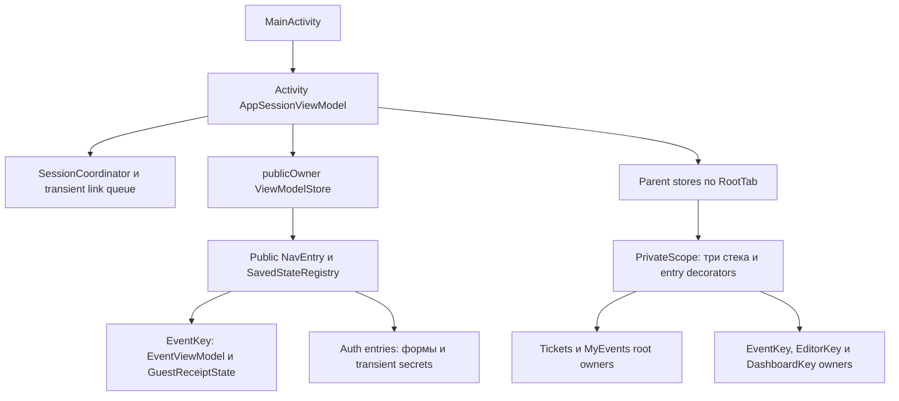
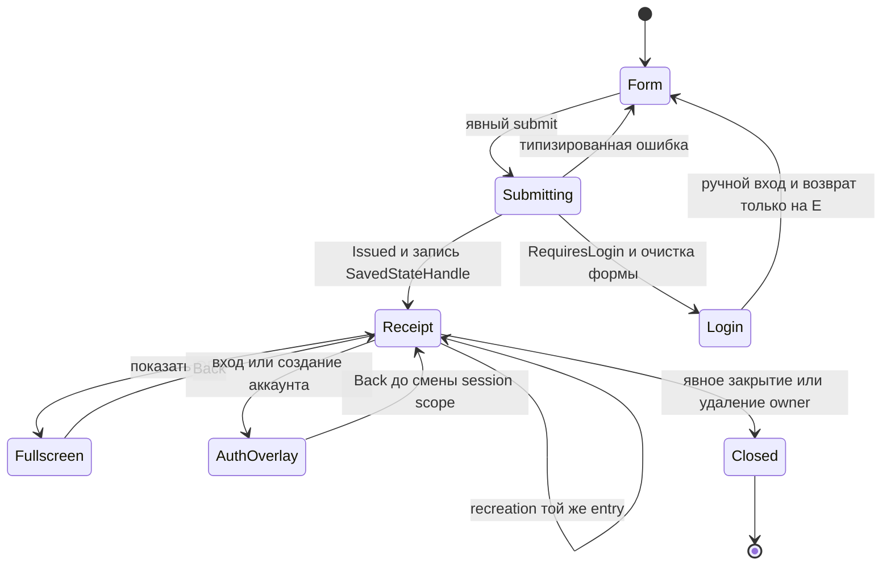

# Владение состоянием и восстановление

M01 remote: [текущие auth/transport/TokenStore owners и очистка](t10-session-transport.md). Bearer хранит TokenStore, не Session/route; Recovery не восстанавливает private UI. Auth формы принадлежат Nav3 entry, remote profile — private account scope.

UI T01–T09: прежние public/private owners сохранены, Scanner/Volunteers получили собственные entry VM. Основные источники — [PrivateShell](../../app/src/demo/kotlin/ru/eventpass/app/navigation/EventPassApp.kt), [T07 lifecycle](t07-ui-lifecycle.md).

## Дерево владельцев

Стрелки показывают владение/структуру, не Gradle-зависимости. Compose `key(PrivateScope)` отделяет приватный saveable state. Декорируются все три стека, включая скрытые; обычное переключение табов не уничтожает их ViewModels. При logout/expiry/смене scope очищаются parent stores, включая root и hidden entries. Очистить только список ключей недостаточно.

## Матрица сроков жизни

| Данные | Владелец и носитель | Поворот | Новый процесс / та же задача | Удаление flow / logout / новый запуск |
|---|---|---|---|---|
| Текущая session | Auth backend, память singleton | Сохраняется в процессе | Не persist: Unknown → Guest, ручной login | Logout очищает; server records остаются |
| Pending destination, login email | Activity VM + SavedStateHandle | Сохраняются | Безопасные значения восстанавливаются | Назначение потребляется/очищается; это не анкета |
| Confirmation URI/token и retry | Очередь/handler Activity VM, только память | Необработанная доставка остаётся | Не сериализуются; может понадобиться повтор исходной ссылки | После обработки/очистки владельца больше не держатся |
| Пароль/reset code/grant | Auth entry VM, только память | Могут жить пока жива entry VM | Не восстанавливаются из SavedStateHandle | Очищаются по переходу/успеху/удалению owner |
| Незавершённая регистрационная форма | EventViewModel, память | Живёт при сохранении той же VM | Не восстанавливается | `leaveForm` очищает ответы при уходе; login не завершает заявку |
| Выданный guest receipt + guest fullscreen | EventKey VM + SavedStateHandle | Восстанавливается у того же flow | Восстановление той же Android-задачи возвращает snapshot | `close`/удаление owner очищают; новый task не ищет билет по ID |
| Private tab stacks/выбранная вкладка | PrivateShell + NavigationState saveable | Сохраняются при действующей сессии | Не доверяются без matching PrivateScope/session | Logout/expiry уничтожают state/owners |
| Выбранный свой ticket/history | Tickets root VM + SavedStateHandle; TicketsRoute обрабатывает Back карточки | Сохраняются | ID может восстановиться только внутри разрешённого scope; данные из repo | Back карточки удаляет выбор, сохраняет history; старые данные не доступны новой личности; fullscreen не persist |
| Scanner result/manual input | ScannerKey VM, только память; permission-request marker saveable, grant всегда проверяется ОС | Background/hidden/recreation → ready, старый допуск не показывается | Access проверяется заново | Pop/logout очищает VM; foreground(false) очищает input/result |
| Volunteers list/input/confirmation/revokeError | VolunteersKey VM, только память; revoke error и retry внутри Dialog | При RESUMED перечитывается | Не persist | Hidden/background/pop отменяет commands/observation и очищает UI |
| Dashboard rows/totals/confirmation | DashboardKey VM, память; owner/request/observation generations, coalesced refresh; query в SavedStateHandle | Hidden/background/navigation → clear/read заново | Авторизация/page 1 заново, без PII из saved state | Pop/logout/denied отменяют jobs, очищают PII и confirmation |
| Profile fields/dirty/confirmation | RootTab.Profile VM, только память; saved profile в общем snapshot | Hidden/background → очистить форму, без autosave | Последняя сохранённая версия; PII не в SavedStateHandle | requestLeave: Save/Discard; logout очищает owner |
| Document picker/export/resend | VM Tickets root/Dashboard entry; memory request/session stamp/jobs/error, route saveable только launch ID | SAF pause/configuration recreation сохраняет pending/writer через идемпотентный bind; настоящий dispose/смена ресурса/таба очищает | Pending result без VM игнорируется; temp очищается startup | Logout/hidden отменяют job; итоговый доступ проверяется перед bytes/успехом |
| MyEvents tab | MyEvents VM + SavedStateHandle | Сохраняется | Только с допустимым private scope | Новый scope получает новый owner |
| Несохранённый EditorInput/dirty/busy | EditorKey VM, память | Живёт в той же entry VM | Raw input не гарантирован; persisted draft перечитывается | Dirty Back: save/discard/stay; нет autosave |
| Сохранённый draft/E/ticket/account | FakeProductState + общий disk snapshot | Не зависит от UI | Перечитывается через инициализацию/guards | Logout не удаляет; demo reset заменяет seed |
| Cover descriptor/изображение | Snapshot reference + app-private file; preview entry VM | Descriptor/файл остаются | Managed copy не зависит от source URI grant | GC учитывает ссылки persisted E/drafts; Bitmap временный |

«Новый процесс» и «новый запуск после удаления задачи» различны. Force-stop/переустановка не доказывают OS-restoration. Детали проверенного T05 сценария — [19](../19-t05-validation.md), [script](../../scripts/verify-t05-process-state.ps1). Новый backend/Activity recreation в T06 не означает новый OS process-kill proof редактора.

Внутренний `openEvent` сохраняет текущий таб/стек и владельца вызывающего экрана: root MyEvents с сегментом, EditorKey с result/полями или Tickets с выбором. Системный/top-bar Back удаляет только EventKey. Ссылка/возврат после входа отдельно использует `openLinkedEvent` с родителем Tickets. Back из выбранного билета очищает SavedStateHandle выбора через VM, оставляя current/history; QR/confirmation окна закрываются прежде карточки. Исправление и адресные проверки — [возврат из билета и мероприятия](../23-navigation-back-validation.md).

## Guest flow: состояния и границы

Receipt и fullscreen сейчас — состояния **того же** EventViewModel, не отдельные QR routes. Auth overlay использует EventAuthKey(flowId, screen, entryId), оставляя исходную entry для Back. Успешный вход переключает host на private scope: доступ к билетам затем определяется TicketRepository, а не guest snapshot.

При новой инициализации Unknown → Guest публичный registry не должен уничтожаться. Для этого AppHost сохраняет публичную композицию под Loading; `clearOwners` отдельно отличает смену private scope от начального чтения сессии. Точная реализация в указанных исходниках важнее одного имени gate.

## Поколения: три разных понятия

| Счётчик/версия | Где | Что защищает |
|---|---|---|
| SessionSnapshot.generation / PrivateScope | Auth/session coordinator/host | Старый аккаунт и недействительная сессия не возвращают приватный UI |
| `commandGeneration` EventViewModel | UI, Long, только память | Exit/actor/resource/denial инвалидируют старые result/finally; questions refresh не теряет принятый submit |
| Event.localSchemaRevision/revision | Nullable, fake-only локальные preconditions | Remote = null, backend formVersion/write precondition отсутствуют |
| Event/Draft.revision | Domain + persisted editor | Lost update между устаревшими редакторами |
| `generation` EditorViewModel | UI, не сохраняется | Поздние save/cover/finally не меняют новую привязку entry |

Не использовать один счётчик вместо другого. Отмена coroutine не является откатом уже выполненной disk-записи; UI обязан отбрасывать устаревший результат независимо от того, когда завершится вызов.

## Независимая модель scanner T07

ScannerController принадлежит ScannerViewModel конкретной ScannerKey entry; onCleared закрывает controller. Route сообщает foreground только для текущей visible entry при RESUMED; при hidden/dispose/background false отменяет pending и очищает result/input. QrCameraPreview живёт только при cameraActive, permission и visible; dispose unbind собственных use cases, clearAnalyzer/shutdown executor, guard pending provider/callback. Новая ViewModel/process начинает access/ready без credential/Admitted. [Wiring и ограничения](t07-ui-lifecycle.md).

## Что проверить при новой навигации

1. Public/private route и способ проверки доступа до показа данных.
2. Уникальность entry ID для нового визита и сохранение owner для Back/rotation.
3. Содержимое route/SavedStateHandle: только нужный безопасный ID; guest receipt — специальный ограниченный flow, auth secrets запрещены.
4. Удаление root/hidden/nested owners при смене сессии; отсутствие фоновой platform-работы скрытой фичи.
5. Жизнь подписки/операции при Back, late result/finally и повторном входе.

Доказательства — [invariants](invariants.md), [T07 UI](../24-t07-ui-validation.md). Чистая модель, Android lifecycle и контролируемый decoder проверяются раздельно; физическая camera/UI приёмка ожидается.

Путь профиля/SAF и границы уже переданных provider байтов — [T09](t09-profile-files.md).

## Read lifecycle T09a

Tickets/MyEvents/Event, как Dashboard/Volunteers/Profile, запускают чтение только для visible + RESUMED. Read job/refreshing/owner/observation — transient память VM, без восстановления business-команды из saved state. Stop отменяет/инвалидирует старое чтение; Tickets/MyEvents сохраняют read-model текущей private scope для selection/scroll, остальные очищают transient state по своей прежней политике. Refresh сохраняет выбранный ticket/сегмент/query/форму при той же схеме, dirty profile и volunteers input. Private scope смена уничтожает старые owners. [T09a](t09a-refresh.md).

## M02: public resource и типизированная анкета

Реализованы отдельные EventSlug/PublicEventReference, RemoteEventRepository public GET, scoped session/owner read guards, совместимые typed answers и bounded UTF-8 schema6/legacy reset policy. Фактические владельцы/последовательности/migration bounds/test pointers — [M02 public E](t10-public-event.md); статус и запущенные проверки — [implementation](../validation/t10-m02-implementation.md). Guest/idempotency/manual-code/tickets/PDF мигрированы в M03; оставшиеся editor/scanner/attendance/profile mutations/XLSX/resend cleanup относятся к M04–M09.

## M03: регистрации, билеты и PDF

EventViewModel валидирует новую заявку по текущей анкете один раз; живой pending command сохраняет прежние answers/body/key для явного replay независимо от обновления questions. Saved state по-прежнему содержит только marker, без тела. TicketsViewModel отдельно владеет `data` списка выбранного scope и `selectedCard` с собственными ticket/event/now; Found карточки не изменяет list items/counters. Back/select(null)/смена сегмента очищают selectedCard, private denial/auth очищают приватную карточку/QR; stop отменяет оба observer, а восстановленная selection получает own observer до мгновенного ответа списка.

[Текущие модели, owners, операции, guards, storage и test pointers](t10-registration-tickets.md), [evidence/ограничения](../validation/t10-m03-implementation.md). RemoteRegistrations/RemoteTickets/RemoteTicketDocuments отвечают за protocol/actor/transport; EventViewModel — immutable pending command/receipt; TicketsViewModel — scope/card/visible refresh; DocumentsViewModel + AndroidDocumentFiles — transient SAF и отмена. После ревью 3277e90 исправлены две P2; [проверки исправлений](../validation/t10-m03-p2-fixes.md), повторное независимое ревью ожидается (FIX_REVIEW_PENDING).
